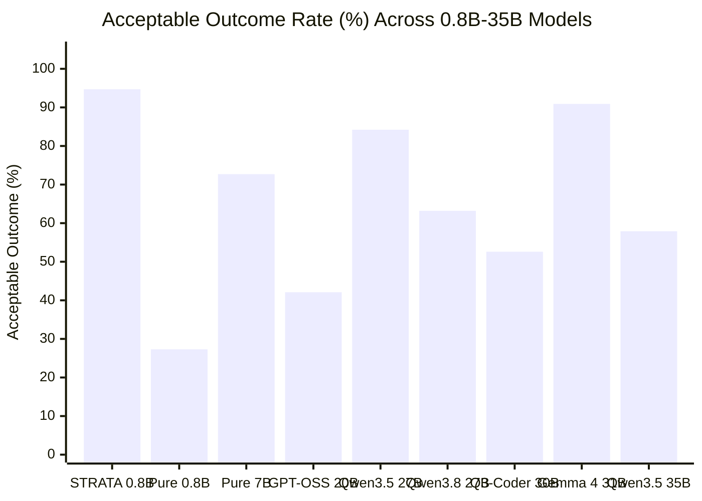
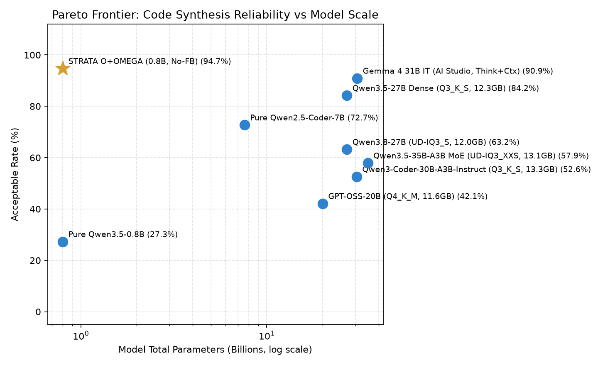
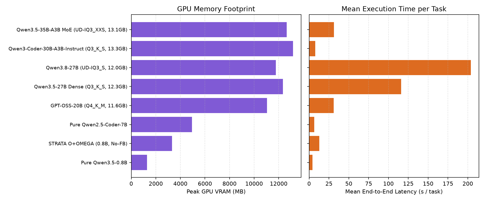

# STRATA: Symbolic Topological Routing Architecture for Typed Automata

[](https://github.com/MatthewNader2/STRATA/actions/workflows/ci.yml)
[](https://colab.research.google.com/github/MatthewNader2/STRATA/blob/main/benchmarks/STRATA_Colab_Benchmark.ipynb)
[-10b981.svg)](#2-interactive-benchmarks--08b-strata-vs-7b35b-pure-llms)
[](LICENSE)
[](https://www.python.org/)
[]()
[]()

**STRATA** (**S**ymbolic **T**opological **R**outing **A**rchitecture for **T**yped **A**utomata) is a category-theoretic neuro-symbolic program synthesis engine. It translates natural language user specifications into provably type-sound, executable, multi-domain Python code pipelines by combining continuous neural semantic intent extraction with constructive category-theoretic compiler passes over a precomputed monoidal lattice of typed morphism cells.

---

## 1. System Architecture

STRATA frames program synthesis as pathfinding and diagrammatic composition over a category of typed computational morphisms:

```
[ Natural Language Specification ]
               │
               ▼
   [ Layer 1: Semantic Routing ] ──────── Dense Sentence Embeddings & Stage-Stratified Tunneling
               │
               ▼
   [ Layer 2: OMEGA A* Planner ] ───────── Monadic Morphism Composition, Typestate & Bridge Insertion
               │
               ▼
   [ Layer 3: Robinson Unifier ] ──────── Dual-Port Typestate Unification (τ_out ⊓ τ_in ≠ ⊥) & Preflight Lint
               │
               ▼
   [ Layer 4: AST Synthesizer ] ───────── Deterministic Python Emission, Scope & Lens Rewiring
               │
               ▼
   [ Layer 5: GEVR Sandbox ] ──────────── Process-Isolated Execution, Egress & Property Verification
```

### Core Engine Layers (`src/`)

- **`src/lattice.py`**: Category-theoretic lattice orchestrator, partially ordered set (poset) type hierarchy, 5-axis typestate semantics, and SQLite storage.
- **`src/router.py`**: Stage-stratified semantic routing engine computing the active topological search tunnel $T = T_1 \cup T_2 \cup T_3$ via dense embedding similarity.
- **`src/planner.py` & `src/route_methods/omega_astar.py`**: Profile **O + OMEGA** type-directed bidirectional A\* planner over symmetric monoidal states $(\text{chain}, \Gamma_t, \sigma_t)$ with algebraic effect tracking (`src/algebraic_effects.py`) and bridge insertion.
- **`src/token_evidence.py` & `src/tokenizer.py`**: Lexical/semantic clause-coverage audit and morphological tokenization for ambiguity detection before code emission.
- **`src/unification.py` & `src/preflight.py`**: Robinson first-order unification gate enforcing algebraic typestates, container shapes, literal-port affinity, and strict preflight lint.
- **`src/synthesis.py`**: Deterministic Python Abstract Syntax Tree (AST) code emission, import resolution, and variable hygiene.
- **`src/gevr_sandbox.py`**: Process-isolated sandbox runtime enforcing CPU, memory, timeout, egress, and postcondition contracts.
- **`src/main.py` & `strata_cli.py`**: FastAPI synthesis server and unified CLI (with `nstl_cli.py` kept as a backward-compatible alias).

---

## 2. Interactive Benchmarks — 0.8B STRATA vs 7B–35B Pure LLMs

Evaluated **deterministic No-Feedback STRATA Profile `O` + `OMEGA` (`Qwen3.5-0.8B`)** against **8 unassisted pure-LLM baselines** ranging from **0.8B to 35B parameters** across **19 benchmarks** spanning multi-library Python composition (`Core 9`, 11 tasks) and unseen proprietary SDKs + realistic cross-domain pipelines + boundary safety tests (`Stress`, 8 tasks), plus the `test.py` Core 8 suite.

### Explore Interactively

| Interactive Resource | Description | Launch / Open |
|---|---|---|
| **Interactive HTML Benchmark Explorer** | Filter by suite (`All 19` / `Core 9` / `Stress`), sort metrics live, toggle Dark/Light mode, and click any task row to inspect prompts, verdicts, and synthesized code | [**Live Preview (htmlpreview)**](https://htmlpreview.github.io/?https://github.com/MatthewNader2/STRATA/blob/main/docs/benchmarks/dashboard.html) · [`docs/benchmarks/dashboard.html`](docs/benchmarks/dashboard.html) |
| **Searchable CSV Dataset** | GitHub natively renders `.csv` files with interactive column search & filtering | [`docs/benchmarks/comparison_summary.csv`](docs/benchmarks/comparison_summary.csv) |
| **Google Colab T4 Benchmark** | Run the Colab T4 pure-LLM baselines (`Qwen3.8-27B`, `GPT-OSS-20B`, `Qwen3-Coder-30B-A3B`, `Qwen3.5-27B`, `Qwen3.5-35B-A3B`) end-to-end | [](https://colab.research.google.com/github/MatthewNader2/STRATA/blob/main/benchmarks/STRATA_Colab_Benchmark.ipynb) |
| **AI Studio Gemma 4 31B Protocol** | Exact system prompt, thinking-enabled protocol, and 11-task ingestion steps for Gemma 4 31B IT | [`benchmarks/AI_STUDIO_GEMMA4_GUIDE.md`](benchmarks/AI_STUDIO_GEMMA4_GUIDE.md) |
| **Raw Markdown Summary** | Auto-generated summary table produced by `benchmarks/visualize_results.py` | [`docs/benchmarks/comparison_summary.md`](docs/benchmarks/comparison_summary.md) |

### Headline Cross-Model Comparison

| Model / Architecture | Params (B) | Core 9 (11) Strict / Acc | Stress (8) Strict / Acc | Overall Strict / Acc | Mean Wall (ms) | Peak VRAM (MB) |
|---|---:|---:|---:|---:|---:|---:|
| **`STRATA O+OMEGA (0.8B, No-FB)`** | **0.8** | **`9/11 (81.8%)` / `11/11 (100.0%)`** | **`6/8 (75.0%)` / `7/8 (87.5%)`** | **`15/19 (78.9%)` / `18/19 (94.7%)`** | **12,984.8** | **3,315.0** |
| `Pure Qwen3.5-0.8B` *(Core 9 only)* | 0.8 | `3/11 (27.3%)` / `3/11 (27.3%)` | — | `3/11 (27.3%)` / `3/11 (27.3%)` | 4,228.6 | 1,293.0 |
| `Pure Qwen2.5-Coder-7B` *(Core 9 only)* | 7.6 | `8/11 (72.7%)` / `8/11 (72.7%)` | — | `8/11 (72.7%)` / `8/11 (72.7%)` | 6,468.1 | 4,955.0 |
| `GPT-OSS-20B (Q4_K_M, 11.6GB)` | 20.0 | `5/11 (45.5%)` / `7/11 (63.6%)` | `0/8 (0.0%)` / `1/8 (12.5%)` | `5/19 (26.3%)` / `8/19 (42.1%)` | 31,029.9 | 11,057.0 |
| `Qwen3.5-27B Dense (Q3_K_S, 12.3GB)` | 27.0 | `9/11 (81.8%)` / `10/11 (90.9%)` | `6/8 (75.0%)` / `6/8 (75.0%)` | `15/19 (78.9%)` / `16/19 (84.2%)` | 116,033.1 | 12,341.0 |
| `Qwen3.8-27B (UD-IQ3_S, 12.0GB)` | 27.0 | `6/11 (54.5%)` / `7/11 (63.6%)` | `4/8 (50.0%)` / `5/8 (62.5%)` | `10/19 (52.6%)` / `12/19 (63.2%)` | 203,859.6 | 11,777.0 |
| `Qwen3-Coder-30B-A3B-Instruct (Q3_K_S, 13.3GB)` | 30.5 | `7/11 (63.6%)` / `7/11 (63.6%)` | `3/8 (37.5%)` / `3/8 (37.5%)` | `10/19 (52.6%)` / `10/19 (52.6%)` | 7,592.8 | 13,167.0 |
| `Gemma 4 31B IT (AI Studio, Think+Ctx)` *(Core 9 only)* | 30.7 | `9/11 (81.8%)` / `10/11 (90.9%)` | — | `9/11 (81.8%)` / `10/11 (90.9%)` | — (Cloud) | — (Cloud) |
| `Qwen3.5-35B-A3B MoE (UD-IQ3_XXS, 13.1GB)` | 35.0 | `7/11 (63.6%)` / `7/11 (63.6%)` | `4/8 (50.0%)` / `4/8 (50.0%)` | `11/19 (57.9%)` / `11/19 (57.9%)` | 31,418.5 | 12,663.0 |

> [!NOTE]
> **Honest Evaluation Notes:**
> - **Acceptable vs. Strict**: Under-specified ambiguity tasks (`vague_game`, `vague_ml`, `bound_ambiguous`) expect clarification/refusal (`LINT_HALTED` for STRATA, `REFUSED_OK` for pure LLMs). `Acceptable` counts verified synthesis **or** clean ambiguity refusal; `Strict` counts verified code execution only. On `Pure 0.8B` and `Pure 7B`, `vague_game` executed without clarifying in the legacy Part 1 harness and is counted in their `3/11` and `8/11` totals per [`comparison_summary.csv`](docs/benchmarks/comparison_summary.csv).
> - **Closed-Domain Mathematical Boundary (`bound_custom_algo`)**: `bound_custom_algo` asks for a scratch `astar_grid(grid, start, goal)` Python implementation outside STRATA's closed domain lattice. STRATA refuses honestly at planning (`PLANNING_FAILED`, zero hallucination), whereas open-ended code LLMs (`Qwen3.5-27B Dense`, `Qwen3.5-35B-A3B MoE`) can synthesize it directly (`1/19` expected trade-off).
> - **Sub-suite Coverage**: Local pure baselines (`0.8B`, `7B`) and Google AI Studio (`Gemma 4 31B IT`, run with thinking enabled and shared chat context) were evaluated on the 11 `Core 9` tasks (`Pure` baselines pre-date the `Stress` suite; Colab T4 GGUF baselines and STRATA `0.8B` were evaluated across all `19` tasks).



<details open>
<summary><strong>📊 Visual Gallery: Accuracy Comparison &amp; Parameter-Scale Pareto Frontier (Figures 1 &amp; 2)</strong></summary>

<p align="center">
  
</p>
<p align="center">
  
</p>

</details>

<details>
<summary><strong>⚡ Visual Gallery: End-to-End Latency &amp; Peak VRAM Footprint (Figure 3)</strong></summary>

<p align="center">
  
</p>

</details>

<details>
<summary><strong>🗺️ Visual Gallery: Full 19-Task Per-Model Heatmap (Figure 4)</strong></summary>

<p align="center">
  
</p>

</details>

<details>
<summary><strong>🧩 Interactive Matrix: Complete 19-Task Breakdown Across All 9 Models</strong></summary>

Legend: ✅ Verified Pass (`PASSED`) · 🛡️ Clean Ambiguity Halt (`LINT_HALTED` / `REFUSED_OK`) · ⚠️ Honest Closed-Domain Halt (`PLANNING_FAILED`) · ⏱️ Empty / Timed-Out Output (`NO_CODE`) · ❌ Verification / Runtime Failure · `—` Not Tested on Suite

| Task | Suite | Group | STRATA 0.8B | Pure 0.8B | Pure 7B | GPT-OSS 20B | Qwen3.5 27B | Qwen3.8 27B | Q3-Coder 30B | Gemma 4 31B | Qwen3.5 35B |
|---|---|---|:---:|:---:|:---:|:---:|:---:|:---:|:---:|:---:|:---:|
| `canonical` | `core9` | `core8` | ✅ | ❌ `SANDBOX_FAILED` | ✅ | ✅ | ✅ | ⏱️ `NO_CODE` | ✅ | ✅ | ⏱️ `NO_CODE` |
| `vague_game` | `core9` | `core8` | 🛡️ `HALT` | ✅ | ✅ | 🛡️ `HALT` | ✅ | ✅ | ✅ | ✅ | ✅ |
| `unvague_game` | `core9` | `core8` | ✅ | ❌ `SANDBOX_FAILED` | ✅ | ⏱️ `NO_CODE` | ❌ `PASSED_UNVERIFIED` | ⏱️ `NO_CODE` | ❌ `PASSED_UNVERIFIED` | ✅ | ⏱️ `NO_CODE` |
| `vague_ml` | `core9` | `core8` | 🛡️ `HALT` | ❌ `SANDBOX_FAILED` | ❌ `SANDBOX_FAILED` | 🛡️ `HALT` | 🛡️ `HALT` | 🛡️ `HALT` | ❌ `SANDBOX_FAILED` | 🛡️ `HALT` | ✅ |
| `cv2_params` | `core9` | `core8` | ✅ | ❌ `SANDBOX_FAILED` | ✅ | ✅ | ✅ | ✅ | ✅ | ✅ | ⏱️ `NO_CODE` |
| `control_flow` | `core9` | `core8` | ✅ | ❌ `SANDBOX_FAILED` | ✅ | ✅ | ✅ | ✅ | ✅ | ✅ | ✅ |
| `crypto` | `core9` | `core8` | ✅ | ❌ `SANDBOX_FAILED` | ❌ `SANDBOX_FAILED` | ⏱️ `NO_CODE` | ✅ | ⏱️ `NO_CODE` | ✅ | ✅ | ✅ |
| `audio` | `core9` | `core8` | ✅ | ❌ `SANDBOX_FAILED` | ❌ `SANDBOX_FAILED` | ⏱️ `NO_CODE` | ✅ | ⏱️ `NO_CODE` | ❌ `SANDBOX_FAILED` | ❌ `SANDBOX_FAILED` | ❌ `SANDBOX_FAILED` |
| `cryo_explicit` | `core9` | `cryopulse` | ✅ | ✅ | ✅ | ❌ `SPEC_FAILED` | ✅ | ✅ | ✅ | ✅ | ✅ |
| `cryo_implicit` | `core9` | `cryopulse` | ✅ | ✅ | ✅ | ✅ | ✅ | ✅ | ❌ `SPEC_FAILED` | ✅ | ✅ |
| `cryo_diag` | `core9` | `cryopulse` | ✅ | ❌ `SPEC_FAILED` | ✅ | ✅ | ✅ | ✅ | ✅ | ✅ | ✅ |
| `aetheris_explicit` | `stress` | `aetheris` | ✅ | — | — | ❌ `SPEC_FAILED` | ✅ | ✅ | ✅ | — | ✅ |
| `aetheris_implicit` | `stress` | `aetheris` | ✅ | — | — | ❌ `SPEC_FAILED` | ✅ | ✅ | ✅ | — | ✅ |
| `aetheris_diag` | `stress` | `aetheris` | ✅ | — | — | ❌ `SPEC_FAILED` | ✅ | ✅ | ❌ `SPEC_FAILED` | — | ✅ |
| `user_etl_sqlite` | `stress` | `user_real` | ✅ | — | — | ❌ `SANDBOX_FAILED` | ❌ `SANDBOX_FAILED` | ❌ `SANDBOX_FAILED` | ❌ `SANDBOX_FAILED` | — | ⏱️ `NO_CODE` |
| `user_cv_contour` | `stress` | `user_real` | ✅ | — | — | ⏱️ `NO_CODE` | ✅ | ✅ | ✅ | — | ⏱️ `NO_CODE` |
| `user_audio_fft_export` | `stress` | `user_real` | ✅ | — | — | ⏱️ `NO_CODE` | ✅ | ⏱️ `NO_CODE` | ❌ `SANDBOX_FAILED` | — | ⏱️ `NO_CODE` |
| `bound_ambiguous` | `stress` | `boundary` | 🛡️ `HALT` | — | — | 🛡️ `HALT` | ❌ `SANDBOX_FAILED` | 🛡️ `HALT` | ❌ `SANDBOX_FAILED` | — | ❌ `SANDBOX_FAILED` |
| `bound_custom_algo` | `stress` | `boundary` | ⚠️ `OOD` | — | — | ⏱️ `NO_CODE` | ✅ | ⏱️ `NO_CODE` | ❌ `PASSED_UNVERIFIED` | — | ✅ |

</details>

<details>
<summary><strong>📈 Round-2 Progress: Before vs. After Universal Fixes (STRATA 0.8B, No-FB)</strong></summary>

| Benchmark Split | Pre-Fix Strict | Pre-Fix Acceptable | Post-Fix (`v7`) Strict | Post-Fix (`v7`) Acceptable |
|---|---:|---:|---:|---:|
| `Core 9` (11 tasks) | `9/11 (81.8%)` | `10/11 (90.9%)` | `9/11 (81.8%)` | **`11/11 (100.0%)` (+9.1 pp)** |
| `Stress` (8 tasks) | `2/8 (25.0%)` | `3/8 (37.5%)` | **`6/8 (75.0%)` (+50.0 pp)** | **`7/8 (87.5%)` (+50.0 pp)** |
| **All 19 Tasks** | **`11/19 (57.9%)`** | **`13/19 (68.4%)`** | **`15/19 (78.9%)` (+21.0 pp)** | **`18/19 (94.7%)` (+26.3 pp)** |
| `test.py` Core 8 (`-p O -m OMEGA`) | — | — | `6/8 (75.0%)` *(6/6 closed-domain)* | **`8/8 (100.0%)` · `0` Defects (93.04s)** |

</details>

<details>
<summary><strong>🧪 Verified Code Showcase: Exact Pipelines Synthesized by 0.8B STRATA (v7)</strong></summary>

All snippets below are verbatim outputs saved from `test_logs/bench_round2_stress_omega_08b_v7/results_strata_omega.json`:

**1. Unseen Proprietary Photonics SDK (`aetheris_explicit` — 14,835 ms, 4 LLM calls):**
```python
import aetheris

opticalbench_1 = aetheris.mount_optical_table(rack_id='OPT-NORTH-2', wavelength_nm=1550.0)
lockedcavity_2 = aetheris.lock_reference_laser(opticalbench_1, cavity_mode='TEM00', power_mw=18.5)
modulatorbank_3 = aetheris.arm_phase_modulator(lockedcavity_2, lane_count=16, vpi_volts=3.6)
fringestack_4 = aetheris.sweep_fringe_interferogram(modulatorbank_3, span_pm=65.0, frames=1024)
phasefield_5 = aetheris.unwrap_phase_residues(fringestack_4, branch_cut='goldstein')
wavefrontmodel_6 = aetheris.solve_zernike_wavefront(phasefield_5, order=8)
str_7 = aetheris.export_phase_lut(wavefrontmodel_6, out_path='zernike_n2.ael')
```

**2. Cross-Domain ETL + SQLite Persistence (`user_etl_sqlite` — 14,687 ms, 9 LLM calls; failed by all 20B–35B pure models):**
```python
import pandas as pd
import sqlite3

dataframe_1 = pd.read_csv('input.csv')
dataframe_2 = dataframe_1.dropna(axis=0, how='any')
series_3 = dataframe_2['X']
series_4 = (series_3 - series_3.min()) / (series_3.max() - series_3.min())
dataframe_5 = dataframe_2.copy()
dataframe_5['X'] = series_4
dataframe_6 = dataframe_5.corr(method='pearson', min_periods=1, numeric_only=True)
connection_7 = sqlite3.connect('metrics.db')
dataframe_6.to_sql(name='clean_data', con=connection_7, if_exists='replace', index=False)
```

**3. Multi-Stage Vision Contour Pipeline (`user_cv_contour` — 15,526 ms, 8 LLM calls):**
```python
import cv2
import numpy as np
import numpy
from PIL import Image
import PIL.Image

ndarray_1 = cv2.imread('input.png', 1)
ndarray_2 = cv2.cvtColor(ndarray_1, cv2.COLOR_BGR2GRAY)
ndarray_3 = cv2.medianBlur(ndarray_2, 5)
float_4, ndarray_5 = cv2.threshold(ndarray_3, 0, 255.0, cv2.THRESH_BINARY | cv2.THRESH_OTSU)
list_contour_6, ndarray_7 = cv2.findContours(ndarray_5, 0, 2)
ndarray_8 = cv2.drawContours(ndarray_1.copy(), list_contour_6, -1, [0, 255, 0], 2)
image_9 = Image.fromarray(ndarray_8)
image_9.save('contours.png', format='PNG', optimize=True)
```

**4. Audio DSP + Spectrogram Export (`user_audio_fft_export` — 8,650 ms, 4 LLM calls):**
```python
from scipy.io import wavfile
from scipy import signal
import matplotlib.pyplot as plt

sample_rate_1, audio_waveform_2 = wavfile.read('input_1.wav')
_sos = signal.butter(4, 4000.0, btype='lowpass', fs=sample_rate_1, output='sos')
audio_waveform_3 = signal.sosfilt(_sos, audio_waveform_2, axis=0)
ndarray_4, ndarray_5, spectrogram_6 = signal.spectrogram(audio_waveform_3, fs=sample_rate_1, nperseg=1024)
plt.imsave('spec_out.png', spectrogram_6, origin='lower', cmap='magma')
file_image_format_7 = 'spec_out.png'
```

</details>

<details>
<summary><strong>🔁 Reproduce All Benchmarks Locally or in Colab</strong></summary>

```bash
# 1. Run Core 8 end-to-end deterministic suite (Profile O + OMEGA)
python test.py -p O -m OMEGA --preset all --mode without-feedback --no-rich

# 2. Run standardized Core 9 (11 tasks) and Stress (8 tasks) suites locally
python benchmarks/run_local.py --arm omega_08b --suite core9  --out-dir test_logs/bench_core9
python benchmarks/run_local.py --arm omega_08b --suite stress --out-dir test_logs/bench_stress

# 3. Aggregate & regenerate comparison tables + Matplotlib figures
python benchmarks/visualize_results.py \
  test_logs/bench_core9/results_strata_omega.json \
  test_logs/bench_stress/results_strata_omega.json \
  --out-dir test_logs/visualizations

# 4. Run 20B-35B pure LLM baselines on Google Colab T4:
#    Open benchmarks/STRATA_Colab_Benchmark.ipynb in Colab
# 5. Ingest AI Studio Gemma 4 31B transcript:
#    Follow benchmarks/AI_STUDIO_GEMMA4_GUIDE.md + benchmarks/ingest_aistudio.py
```

</details>

---

## 3. Repository Layout

```
STRATA/
├── .github/
│   ├── workflows/ci.yml              # Automated GitHub Actions CI & release-flow gates
│   ├── ISSUE_TEMPLATE/               # Structured Bug & Feature request forms
│   ├── CODEOWNERS                    # Required code ownership review rules
│   └── pull_request_template.md      # Standardized PR review checklist
├── benchmarks/
│   ├── STRATA_Colab_Benchmark.ipynb  # Colab T4 notebook for 20B-35B pure-LLM baselines
│   ├── AI_STUDIO_GEMMA4_GUIDE.md     # AI Studio Gemma 4 31B manual benchmark protocol
│   ├── colab_eval.py                 # llama.cpp GGUF evaluation runner
│   ├── run_local.py                  # Local STRATA & baseline suite runner
│   ├── suites.py                     # Core 9 (11 tasks) & Stress (8 tasks) definitions
│   ├── evaluators.py                 # Sandbox & SDK specification evaluators
│   ├── visualize_results.py          # Cross-model table & figure generator
│   └── fixtures/                     # Unseen held-out SDK trees (aetheris, cryopulse)
├── docs/
│   ├── benchmarks/                   # Tracked plots, CSV/MD tables & interactive HTML dashboard
│   ├── archive/                      # Historical audit & remediation planning docs
│   ├── development.md                # Team setup, conventions, and Git workflow
│   ├── models.md                     # Model specifications & download guide
│   └── team_proposal.md              # Project academic proposal and foundations
├── scripts/
│   ├── audit_trees.py                # Strict 5-axis domain tree auditor
│   ├── check_static.py               # Undefined names & static hygiene gate
│   ├── lint_trees.py                 # CI schema & signature linter for domain trees
│   ├── download_model.py             # Hugging Face model downloader
│   └── setup_llama_server.py         # Local llama.cpp server helper
├── src/                              # Core STRATA neuro-symbolic engine source code
├── tests/                            # Unit, regression, and topological test suites
├── trees/                            # 15 canonical domain trees (*.json) & compiled lattice
├── eval_metrics.py                   # Status taxonomy & evidence scoring module
├── strata_cli.py                     # Primary STRATA CLI entry point (alias: nstl_cli.py)
├── test.py                           # Multi-profile end-to-end empirical test harness
├── requirements.txt                  # Core runtime dependencies
└── requirements-dev.txt              # Development, linting, and CI dependencies
```

---

## 4. Recommended & Tested Models

STRATA's neuro-symbolic design allows lightweight models to excel: the neural layer extracts semantic intent, while the category-theoretic engine enforces type soundness and program termination.

### Model Catalog

| Role | Model Identifier | Source / Artifact | Local Destination Path | Footprint |
| :--- | :--- | :--- | :--- | :--- |
| **Default Embedder** | `jina-embeddings-v5-text-nano` | [`jinaai/jina-embeddings-v5-text-nano`](https://huggingface.co/jinaai/jina-embeddings-v5-text-nano) | `models/embeddings/jina-embeddings-v5-text-nano/` | ~350 MB |
| **Default LLM** | `qwen2.5-coder-0.5b-instruct` | [`Qwen/Qwen2.5-Coder-0.5B-Instruct-GGUF`](https://huggingface.co/Qwen/Qwen2.5-Coder-0.5B-Instruct-GGUF) | `models/llms/qwen2.5-coder-0.5b-instruct/` | ~398 MB |
| **Profile O+OMEGA Benchmark LLM** *(Tested)* | `qwen3.5-0.8b-instruct` | `Qwen3.5-0.8B-Q4_K_M.gguf` | `models/llms/qwen3.5-0.8b-instruct/` | ~508 MB |
| **Medium LLM** | `qwen2.5-coder-1.5b-instruct` | [`Qwen/Qwen2.5-Coder-1.5B-Instruct-GGUF`](https://huggingface.co/Qwen/Qwen2.5-Coder-1.5B-Instruct-GGUF) | `models/llms/qwen2.5-coder-1.5b-instruct/` | ~986 MB |
| **Heavy LLM** | `Qwen2.5-Coder-7B-Instruct-GGUF` | [`Qwen/Qwen2.5-Coder-7B-Instruct-GGUF`](https://huggingface.co/Qwen/Qwen2.5-Coder-7B-Instruct-GGUF) | `models/llms/Qwen2.5-Coder-7B-Instruct-GGUF/` | ~4.68 GB |
| **Optional Reranker** | `jina-reranker-v3.5` | [`jinaai/jina-reranker-v3.5`](https://huggingface.co/jinaai/jina-reranker-v3.5) | `models/rerankers/jina-reranker-v3.5/` | ~500 MB |

> [!TIP]
> The **Profile `O` + `OMEGA`** configuration (`Qwen3.5-0.8B-Q4_K_M.gguf` + `jina-embeddings-v5-text-nano`) fits in ~3.2 GB peak VRAM, outperforms unassisted `20B`–`35B` pure LLMs on closed-domain acceptability (`94.7%`), and runs entirely locally.

For full download instructions and hardware tiers, see [docs/models.md](docs/models.md).

---

## 5. Quickstart & Installation

### Step 1: Clone and Set Up Virtual Environment

```bash
git clone https://github.com/MatthewNader2/STRATA.git
cd STRATA

# Create and activate Python virtual environment
python3 -m venv .venv
source .venv/bin/activate    # On Windows: .venv\Scripts\activate

# Install dependencies
pip install -r requirements.txt
pip install -r requirements-dev.txt
```

### Step 2: Provision AI Models

Download the default models with one command:

```bash
python scripts/download_model.py --tier default
```

*(Alternatively, run `python scripts/download_model.py --tier heavy` for GPU 7B evaluations, or place `Qwen3.5-0.8B-Q4_K_M.gguf` under `models/llms/qwen3.5-0.8b-instruct/` for Profile `O` + `OMEGA`.)*

### Step 3: Compile the Domain Knowledge Lattice

Compile the 15 canonical domain trees into the SQLite graph database:

```bash
python strata_cli.py compile
python strata_cli.py validate
```

---

## 6. CLI Usage & Capabilities

STRATA provides a unified command-line toolchain via `strata_cli.py` (with `nstl_cli.py` supported as a backward-compatible alias):

### 1. Interactive Synthesis Studio (TUI)
```bash
python strata_cli.py shell
```

### 2. Direct Pipeline Synthesis
```bash
python strata_cli.py run "load a csv file named input.csv, normalize X column, drop null values, and compute the mean of Y" --profile O --route-method OMEGA
```

### 3. Domain Knowledge Management
- **Compile Trees**: `python strata_cli.py compile` (compiles `trees/*.json` into `trees/lattice.db`)
- **Validate Nodes**: `python strata_cli.py validate` (AST and schema validation over all nodes)
- **Topological Audit**: `python strata_cli.py audit` (reachability, dead ends, and cross-domain bridge diagnostics)

### 4. REST API Server
```bash
python src/main.py
```
API documentation is served at `http://127.0.0.1:58102/docs`.

---

## 7. Domain Knowledge Trees (`trees/`)

STRATA includes **15 canonical domain trees** compiling to **1,049 verified morphism cells** (`3,611` 5-axis ports) and **35,673 dynamic topological edges** (plus isolated unseen SDK fixtures `aetheris` and `cryopulse` under `benchmarks/fixtures/`):

- **Core Analytics & Data**: `numpy.json`, `pandas.json`, `sklearn.json`
- **Visualization**: `matplotlib.json`, `seaborn.json`
- **Media & Perception**: `cv2.json` (OpenCV), `pillow.json`, `audio.json` (SciPy Signal / WAV)
- **Specialized Domains**: `cryptography.json`, `pygame.json`, `requests.json`, `sqlite3.json`
- **Control & Primitives**: `control_flow.json`, `python_core.json`, `pathlib.json`

---

## 8. Development, Testing & CI/CD

### Pre-PR Quality Gates
Run all CI checks before opening a PR (mirrored from `.github/workflows/ci.yml`):

```bash
# 1. Static hygiene, undefined names & zero-frozenset gate
python scripts/check_static.py

# 2. Domain tree schema, inspect.signature & strict 5-axis audits
python scripts/lint_trees.py
python scripts/audit_trees.py --strict-five-axis

# 3. Lattice compilation, AST validation & topological audit
python strata_cli.py compile
python strata_cli.py validate
python strata_cli.py audit

# 4. Core symbolic & topological soundness tests
pytest tests/test_soundness_topology.py
```

### Team Git Workflow
- **`main`**: Release-ready code only. Changes enter exclusively via PR from `dev` (`Enforce Release Flow` CI check).
- **`dev`**: Active integration branch where feature and fix PRs land first.
- **`feat/*`, `fix/*`, `docs/*`**: Isolated task branches targeting `dev`.

For full development details, review [docs/development.md](docs/development.md) and [CONTRIBUTING.md](CONTRIBUTING.md).

---

## 9. License & Academic Citation

STRATA is released under the **Source-Available Research and Non-Commercial License (incorporating PolyForm Noncommercial 1.0.0)**.

- **Research & Non-Commercial Use**: Free for academic, scientific, and educational research, personal evaluation, and non-commercial tool development.
- **Commercial Use Restriction**: Any commercial use, proprietary incorporation, cloud hosting (SaaS), or monetization is strictly prohibited without prior written consent and an explicit commercial license.
- **Commercial Inquiries**: Contact Matthew Nader at `matthewnader2@gmail.com`.

If you use STRATA in your research or as a tool in your experiments, please cite:

```bibtex
@software{strata2026,
  author = {Nader, Matthew and Contributors},
  title = {{STRATA}: Symbolic Topological Routing Architecture for Typed Automata},
  year = {2026},
  url = {https://github.com/MatthewNader2/STRATA},
  note = {Category-theoretic neuro-symbolic program synthesis engine}
}
```

See the full terms in [LICENSE](LICENSE).
