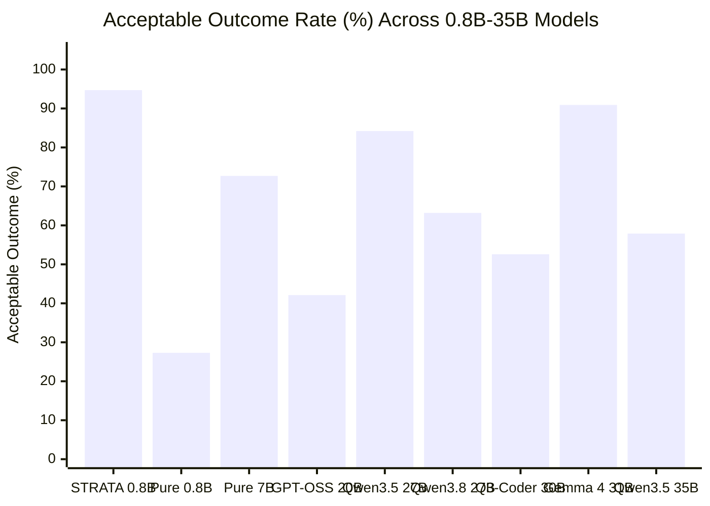
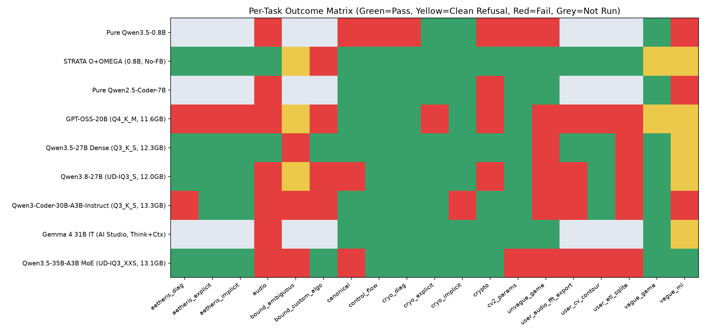
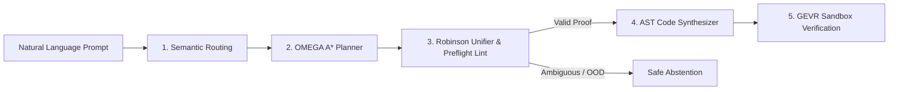

<div align="center">

# STRATA

**Symbolic Topological Routing Architecture for Typed Automata**

*Provably type-sound Python synthesis from a 0.8B model — matching or outperforming 27B–35B pure LLMs in ~3.2 GB VRAM.*

[](https://github.com/MatthewNader2/STRATA/actions/workflows/ci.yml)
[](https://www.python.org/)
[](LICENSE)
[](https://colab.research.google.com/github/MatthewNader2/STRATA/blob/main/benchmarks/STRATA_Colab_Benchmark.ipynb)
[](https://htmlpreview.github.io/?https://github.com/MatthewNader2/STRATA/blob/main/docs/benchmarks/dashboard.html)
[](#benchmarks)

[Why STRATA](#why-strata) · [Benchmarks](#benchmarks) · [Architecture](#architecture) · [Quickstart](#quickstart) · [Supported Domains](#supported-domains) · [CLI & API Usage](#cli--api-usage) · [Citation](#license--citation)

<br />


*Parameter scale vs. benchmark outcome across 0.8B–35B architectures: grounding an 800M model in a typed morphism lattice eliminates scaling bottlenecks without sacrificing execution safety.*

</div>

---

## Why STRATA?

Large language models generate code token-by-token, trading API precision and runtime guarantees for parameter count. **STRATA** separates **semantic intent** (handled by a compact neural model) from **program composition and verification** (handled constructively by category theory and unification):

- **Constructive Typestate Soundness**: Pipelines are composed over a precompiled symmetric monoidal lattice (`τ_out ⊓ τ_in ≠ ⊥`) with linear handle tracking and Robinson first-order unification before any Python is emitted.
- **Small Models, Frontier Reliability**: Grounding `Qwen3.5-0.8B` inside STRATA lifts its Core Suite acceptable rate from **`27.3%` to `100.0%`** and matches `Qwen3.5-27B Dense` on strict synthesis (`15/19 = 78.9%`) at **33.7× fewer parameters** and **8.9× lower latency**.
- **Honest Abstention Over Hallucination**: When a specification is ambiguous (`vague_game`, `vague_ml`, `bound_ambiguous`) or falls outside the closed domain lattice (`bound_custom_algo`), STRATA halts at static verification instead of emitting broken code.
- **Zero-Shot Proprietary SDK Adaptation**: Adding a declarative JSON specification lets STRATA compose novel APIs (evaluated on held-out photonics and cryogenics SDKs) without retraining or fine-tuning weights.

---

## Benchmarks

Evaluated **STRATA (`Qwen3.5-0.8B`)** without multi-turn LLM repair against **8 unassisted pure-LLM baselines (`0.8B`–`35B`)** across **19 benchmarks** covering multi-library data/vision/DSP synthesis (**Core Suite**, 11 tasks) plus unseen proprietary SDKs, cross-domain file/SQL pipelines, and abstention boundaries (**Stress Suite**, 8 tasks).

### Interactive Tools & Raw Artifacts

| Resource | What It Provides | Open |
|---|---|---|
| **Interactive Benchmark Explorer** | Suite filters (`All 19` / `Core` / `Stress`), metric selector, sortable table, Light/Dark toggle, and clickable task inspector with emitted Python pipelines | [**Live Dashboard**](https://htmlpreview.github.io/?https://github.com/MatthewNader2/STRATA/blob/main/docs/benchmarks/dashboard.html) · [`docs/benchmarks/dashboard.html`](docs/benchmarks/dashboard.html) |
| **Searchable CSV Dataset** | Native GitHub interactive table with column search and filtering | [`docs/benchmarks/comparison_summary.csv`](docs/benchmarks/comparison_summary.csv) |
| **Colab T4 Baseline Notebook** | Reproducible GGUF evaluation harness for `20B`–`35B` models on a single T4 GPU | [`benchmarks/STRATA_Colab_Benchmark.ipynb`](benchmarks/STRATA_Colab_Benchmark.ipynb) |
| **AI Studio Gemma 4 31B Guide** | Exact evaluation prompts, thinking configuration, and transcript ingestion workflow | [`benchmarks/AI_STUDIO_GEMMA4_GUIDE.md`](benchmarks/AI_STUDIO_GEMMA4_GUIDE.md) |

### Cross-Model Summary (`0.8B` STRATA vs. `0.8B`–`35B` Pure LLMs)

| Model / System | Params | Core Suite (11) Strict / Acc | Stress Suite (8) Strict / Acc | Overall (19) Strict / Acc | Mean Latency | Peak VRAM |
|---|---:|---:|---:|---:|---:|---:|
| **`STRATA (Qwen3.5-0.8B)`** | **0.8B** | **`9/11 (81.8%)` / `11/11 (100.0%)`** | **`6/8 (75.0%)` / `7/8 (87.5%)`** | **`15/19 (78.9%)` / `18/19 (94.7%)`** | **12,984.8 ms** | **3,315.0 MB** |
| `Pure Qwen3.5-0.8B` *(Core only)* | 0.8B | `3/11 (27.3%)` / `3/11 (27.3%)` | — | `3/11 (27.3%)` / `3/11 (27.3%)` | 4,228.6 ms | 1,293.0 MB |
| `Pure Qwen2.5-Coder-7B` *(Core only)* | 7.6B | `8/11 (72.7%)` / `8/11 (72.7%)` | — | `8/11 (72.7%)` / `8/11 (72.7%)` | 6,468.1 ms | 4,955.0 MB |
| `GPT-OSS-20B (Q4_K_M)` | 20.0B | `5/11 (45.5%)` / `7/11 (63.6%)` | `0/8 (0.0%)` / `1/8 (12.5%)` | `5/19 (26.3%)` / `8/19 (42.1%)` | 31,029.9 ms | 11,057.0 MB |
| `Qwen3.5-27B Dense (Q3_K_S)` | 27.0B | `9/11 (81.8%)` / `10/11 (90.9%)` | `6/8 (75.0%)` / `6/8 (75.0%)` | `15/19 (78.9%)` / `16/19 (84.2%)` | 116,033.1 ms | 12,341.0 MB |
| `Qwen3.8-27B (UD-IQ3_S)` | 27.0B | `6/11 (54.5%)` / `7/11 (63.6%)` | `4/8 (50.0%)` / `5/8 (62.5%)` | `10/19 (52.6%)` / `12/19 (63.2%)` | 203,859.6 ms | 11,777.0 MB |
| `Qwen3-Coder-30B-A3B (Q3_K_S)` | 30.5B | `7/11 (63.6%)` / `7/11 (63.6%)` | `3/8 (37.5%)` / `3/8 (37.5%)` | `10/19 (52.6%)` / `10/19 (52.6%)` | 7,592.8 ms | 13,167.0 MB |
| `Gemma 4 31B IT` *(AI Studio, Think+Ctx)* | 30.7B | `9/11 (81.8%)` / `10/11 (90.9%)` | — | `9/11 (81.8%)` / `10/11 (90.9%)` | Cloud API | Cloud API |
| `Qwen3.5-35B-A3B MoE (UD-IQ3_XXS)` | 35.0B | `7/11 (63.6%)` / `7/11 (63.6%)` | `4/8 (50.0%)` / `4/8 (50.0%)` | `11/19 (57.9%)` / `11/19 (57.9%)` | 31,418.5 ms | 12,663.0 MB |

> [!NOTE]
> **Evaluation Methodology:**
> - **Strict vs. Acceptable**: Under-specified ambiguity tasks (`vague_game`, `vague_ml`, `bound_ambiguous`) expect clarification/abstention (`LINT_HALTED` or `REFUSED_OK`). **Acceptable** counts verified code execution **or** clean ambiguity refusal; **Strict** counts verified execution only. On `Pure 0.8B` and `Pure 7B`, `vague_game` executed without clarifying and is counted in their `3/11` and `8/11` totals per [`comparison_summary.csv`](docs/benchmarks/comparison_summary.csv).
> - **Closed-Domain Boundary (`bound_custom_algo`)**: Requests an unconstrained recursive `astar_grid(grid, start, goal)` implementation outside STRATA's closed domain lattice. STRATA refuses cleanly during planning (`PLANNING_FAILED`), whereas unconstrained `27B` and `35B` models can synthesize it directly (`1/19` structural boundary).
> - **Suite Scope**: `Pure 0.8B`, `Pure 7B`, and `Gemma 4 31B IT` (run with thinking enabled in shared chat context) were benchmarked on the `11` Core Suite tasks; STRATA `0.8B` and all `5` Colab T4 GGUF baselines were evaluated across all `19` tasks. On the standalone 8-preset Core Suite (`test.py`), STRATA `0.8B` achieves `8/8 (100.0%)` acceptable outcomes (`6/6` closed-domain passes, `2/2` ambiguity refusals, `0` defects).



<details open>
<summary><strong>📊 Accuracy &amp; Resource Footprint Charts (Figures 1 &amp; 3)</strong></summary>

<p align="center">
  
</p>
<p align="center">
  
</p>

</details>

<details>
<summary><strong>🗺️ Full 19-Task Visual Heatmap (Figure 4)</strong></summary>

<p align="center">
  
</p>

</details>

<details>
<summary><strong>🧩 Complete 19-Task Per-Model Status Matrix</strong></summary>

Legend: ✅ Verified Pass (`PASSED`) · 🛡️ Clean Ambiguity Halt (`LINT_HALTED` / `REFUSED_OK`) · ⚠️ Honest Closed-Domain Halt (`PLANNING_FAILED`) · ⏱️ Empty / Timed-Out Output (`NO_CODE`) · ❌ Verification / Runtime Failure · `—` Not Tested on Suite

| Task | Suite | Group | STRATA 0.8B | Pure 0.8B | Pure 7B | GPT-OSS 20B | Qwen3.5 27B | Qwen3.8 27B | Q3-Coder 30B | Gemma 4 31B | Qwen3.5 35B |
|---|---|---|:---:|:---:|:---:|:---:|:---:|:---:|:---:|:---:|:---:|
| `canonical` | `core9` | `core8` | ✅ | ❌ `SANDBOX_FAILED` | ✅ | ✅ | ✅ | ⏱️ `NO_CODE` | ✅ | ✅ | ⏱️ `NO_CODE` |
| `vague_game` | `core9` | `core8` | 🛡️ `HALT` | ✅ | ✅ | 🛡️ `HALT` | ✅ | ✅ | ✅ | ✅ | ✅ |
| `unvague_game` | `core9` | `core8` | ✅ | ❌ `SANDBOX_FAILED` | ✅ | ⏱️ `NO_CODE` | ❌ `PASSED_UNVERIFIED` | ⏱️ `NO_CODE` | ❌ `PASSED_UNVERIFIED` | ✅ | ⏱️ `NO_CODE` |
| `vague_ml` | `core9` | `core8` | 🛡️ `HALT` | ❌ `SANDBOX_FAILED` | ❌ `SANDBOX_FAILED` | 🛡️ `HALT` | 🛡️ `HALT` | 🛡️ `HALT` | ❌ `SANDBOX_FAILED` | 🛡️ `HALT` | ✅ |
| `cv2_params` | `core9` | `core8` | ✅ | ❌ `SANDBOX_FAILED` | ✅ | ✅ | ✅ | ✅ | ✅ | ✅ | ⏱️ `NO_CODE` |
| `control_flow` | `core9` | `core8` | ✅ | ❌ `SANDBOX_FAILED` | ✅ | ✅ | ✅ | ✅ | ✅ | ✅ | ✅ |
| `crypto` | `core9` | `core8` | ✅ | ❌ `SANDBOX_FAILED` | ❌ `SANDBOX_FAILED` | ⏱️ `NO_CODE` | ✅ | ⏱️ `NO_CODE` | ✅ | ✅ | ✅ |
| `audio` | `core9` | `core8` | ✅ | ❌ `SANDBOX_FAILED` | ❌ `SANDBOX_FAILED` | ⏱️ `NO_CODE` | ✅ | ⏱️ `NO_CODE` | ❌ `SANDBOX_FAILED` | ❌ `SANDBOX_FAILED` | ❌ `SANDBOX_FAILED` |
| `cryo_explicit` | `core9` | `cryopulse` | ✅ | ✅ | ✅ | ❌ `SPEC_FAILED` | ✅ | ✅ | ✅ | ✅ | ✅ |
| `cryo_implicit` | `core9` | `cryopulse` | ✅ | ✅ | ✅ | ✅ | ✅ | ✅ | ❌ `SPEC_FAILED` | ✅ | ✅ |
| `cryo_diag` | `core9` | `cryopulse` | ✅ | ❌ `SPEC_FAILED` | ✅ | ✅ | ✅ | ✅ | ✅ | ✅ | ✅ |
| `aetheris_explicit` | `stress` | `aetheris` | ✅ | — | — | ❌ `SPEC_FAILED` | ✅ | ✅ | ✅ | — | ✅ |
| `aetheris_implicit` | `stress` | `aetheris` | ✅ | — | — | ❌ `SPEC_FAILED` | ✅ | ✅ | ✅ | — | ✅ |
| `aetheris_diag` | `stress` | `aetheris` | ✅ | — | — | ❌ `SPEC_FAILED` | ✅ | ✅ | ❌ `SPEC_FAILED` | — | ✅ |
| `user_etl_sqlite` | `stress` | `user_real` | ✅ | — | — | ❌ `SANDBOX_FAILED` | ❌ `SANDBOX_FAILED` | ❌ `SANDBOX_FAILED` | ❌ `SANDBOX_FAILED` | — | ⏱️ `NO_CODE` |
| `user_cv_contour` | `stress` | `user_real` | ✅ | — | — | ⏱️ `NO_CODE` | ✅ | ✅ | ✅ | — | ⏱️ `NO_CODE` |
| `user_audio_fft_export` | `stress` | `user_real` | ✅ | — | — | ⏱️ `NO_CODE` | ✅ | ⏱️ `NO_CODE` | ❌ `SANDBOX_FAILED` | — | ⏱️ `NO_CODE` |
| `bound_ambiguous` | `stress` | `boundary` | 🛡️ `HALT` | — | — | 🛡️ `HALT` | ❌ `SANDBOX_FAILED` | 🛡️ `HALT` | ❌ `SANDBOX_FAILED` | — | ❌ `SANDBOX_FAILED` |
| `bound_custom_algo` | `stress` | `boundary` | ⚠️ `OOD` | — | — | ⏱️ `NO_CODE` | ✅ | ⏱️ `NO_CODE` | ❌ `PASSED_UNVERIFIED` | — | ✅ |

</details>

<details>
<summary><strong>🧪 Synthesized Pipeline Examples from 0.8B STRATA</strong></summary>

Exact Python pipelines synthesized and verified end-to-end by `STRATA (Qwen3.5-0.8B)`:

**Unseen Proprietary Photonics SDK (`aetheris_explicit` — 14,835 ms, 4 LLM calls):**
```python
import aetheris

opticalbench_1 = aetheris.mount_optical_table(rack_id='OPT-NORTH-2', wavelength_nm=1550.0)
lockedcavity_2 = aetheris.lock_reference_laser(opticalbench_1, cavity_mode='TEM00', power_mw=18.5)
modulatorbank_3 = aetheris.arm_phase_modulator(lockedcavity_2, lane_count=16, vpi_volts=3.6)
fringestack_4 = aetheris.sweep_fringe_interferogram(modulatorbank_3, span_pm=65.0, frames=1024)
phasefield_5 = aetheris.unwrap_phase_residues(fringestack_4, branch_cut='goldstein')
wavefrontmodel_6 = aetheris.solve_zernike_wavefront(phasefield_5, order=8)
str_7 = aetheris.export_phase_lut(wavefrontmodel_6, out_path='zernike_n2.ael')
```

**Cross-Domain ETL & SQLite Persistence (`user_etl_sqlite` — 14,687 ms, 9 LLM calls; failed by all 20B–35B pure baselines):**
```python
import pandas as pd
import sqlite3

dataframe_1 = pd.read_csv('input.csv')
dataframe_2 = dataframe_1.dropna(axis=0, how='any')
series_3 = dataframe_2['X']
series_4 = (series_3 - series_3.min()) / (series_3.max() - series_3.min())
dataframe_5 = dataframe_2.copy()
dataframe_5['X'] = series_4
dataframe_6 = dataframe_5.corr(method='pearson', min_periods=1, numeric_only=True)
connection_7 = sqlite3.connect('metrics.db')
dataframe_6.to_sql(name='clean_data', con=connection_7, if_exists='replace', index=False)
```

**Multi-Stage OpenCV + Pillow Contour Export (`user_cv_contour` — 15,526 ms, 8 LLM calls):**
```python
import cv2
import numpy as np
import numpy
from PIL import Image
import PIL.Image

ndarray_1 = cv2.imread('input.png', 1)
ndarray_2 = cv2.cvtColor(ndarray_1, cv2.COLOR_BGR2GRAY)
ndarray_3 = cv2.medianBlur(ndarray_2, 5)
float_4, ndarray_5 = cv2.threshold(ndarray_3, 0, 255.0, cv2.THRESH_BINARY | cv2.THRESH_OTSU)
list_contour_6, ndarray_7 = cv2.findContours(ndarray_5, 0, 2)
ndarray_8 = cv2.drawContours(ndarray_1.copy(), list_contour_6, -1, [0, 255, 0], 2)
image_9 = Image.fromarray(ndarray_8)
image_9.save('contours.png', format='PNG', optimize=True)
```

**Audio Signal Processing & Spectrogram Export (`user_audio_fft_export` — 8,650 ms, 4 LLM calls):**
```python
from scipy.io import wavfile
from scipy import signal
import matplotlib.pyplot as plt

sample_rate_1, audio_waveform_2 = wavfile.read('input_1.wav')
_sos = signal.butter(4, 4000.0, btype='lowpass', fs=sample_rate_1, output='sos')
audio_waveform_3 = signal.sosfilt(_sos, audio_waveform_2, axis=0)
ndarray_4, ndarray_5, spectrogram_6 = signal.spectrogram(audio_waveform_3, fs=sample_rate_1, nperseg=1024)
plt.imsave('spec_out.png', spectrogram_6, origin='lower', cmap='magma')
file_image_format_7 = 'spec_out.png'
```

</details>

<details>
<summary><strong>🔁 Reproducing the Benchmarks</strong></summary>

```bash
# 1. Core 8 deterministic evaluation suite (Profile O + OMEGA)
python test.py -p O -m OMEGA --preset all --mode without-feedback --no-rich

# 2. Standardized 19-task suites (11 Core + 8 Stress)
python benchmarks/run_local.py --arm omega_08b --suite core9  --out-dir test_logs/bench_core9
python benchmarks/run_local.py --arm omega_08b --suite stress --out-dir test_logs/bench_stress

# 3. Regenerate Markdown/CSV tables & Matplotlib comparison figures
python benchmarks/visualize_results.py \
  test_logs/bench_core9/results_strata_omega.json \
  test_logs/bench_stress/results_strata_omega.json \
  --out-dir test_logs/visualizations

# 4. Run 20B-35B GGUF baselines on Google Colab T4:
#    Open benchmarks/STRATA_Colab_Benchmark.ipynb
# 5. Evaluate Gemma 4 31B IT in Google AI Studio:
#    Follow benchmarks/AI_STUDIO_GEMMA4_GUIDE.md + benchmarks/ingest_aistudio.py
```

</details>

---

## Architecture

STRATA compiles domain specifications into a SQLite-backed monoidal lattice and executes a five-stage neuro-symbolic synthesis pipeline:



| Stage | Responsibility | Core Modules |
|---|---|---|
| **1. Semantic Routing** | Dense embedding retrieval & stage-stratified search tunnel construction | [`src/router.py`](src/router.py), [`src/tokenizer.py`](src/tokenizer.py), [`src/token_evidence.py`](src/token_evidence.py) |
| **2. OMEGA A\* Planner** | Bidirectional type-directed search over monoidal states, typestates, handles & bridges | [`src/planner.py`](src/planner.py), [`src/route_methods/omega_astar.py`](src/route_methods/omega_astar.py), [`src/algebraic_effects.py`](src/algebraic_effects.py) |
| **3. Robinson Unification** | Dual-port type/shape unification, literal-port binding & preflight verification | [`src/unification.py`](src/unification.py), [`src/preflight.py`](src/preflight.py), [`src/lattice.py`](src/lattice.py) |
| **4. AST Synthesizer** | Deterministic Python emission, import resolution & variable lineage hygiene | [`src/synthesis.py`](src/synthesis.py) |
| **5. GEVR Sandbox** | Process-isolated execution, egress verification & postcondition contracts | [`src/gevr_sandbox.py`](src/gevr_sandbox.py) |

---

## Quickstart

### 1. Install Dependencies

```bash
git clone https://github.com/MatthewNader2/STRATA.git
cd STRATA

python3 -m venv .venv
source .venv/bin/activate    # Windows: .venv\Scripts\activate

pip install -r requirements.txt
pip install -r requirements-dev.txt
```

### 2. Download Models

```bash
# Default local tier (~750 MB total: 0.5B Coder GGUF + Jina Embedder Nano)
python scripts/download_model.py --tier default
```

For GPU 7B evaluations, run `python scripts/download_model.py --tier heavy`. For Profile `O` + `OMEGA` (`0.8B`), place `Qwen3.5-0.8B-Q4_K_M.gguf` under `models/llms/qwen3.5-0.8b-instruct/`. See [docs/models.md](docs/models.md) for the complete provisioning guide.

### 3. Compile Lattice & Synthesize

```bash
python strata_cli.py compile
python strata_cli.py validate
python strata_cli.py run "load a csv file named input.csv, normalize X column, drop null values, and compute the mean of Y" --profile O --route-method OMEGA
```

---

## Supported Domains

STRATA ships **15 canonical domain trees** compiling to **1,049 verified morphism cells**, **3,611 5-axis ports**, and **35,673 dynamic topological edges**:

| Category | Domain Trees (`trees/*.json`) |
|---|---|
| **Data & Machine Learning** | `numpy.json`, `pandas.json`, `sklearn.json` |
| **Visualization** | `matplotlib.json`, `seaborn.json` |
| **Computer Vision & Audio DSP** | `cv2.json`, `pillow.json`, `audio.json` |
| **Security, Web, Storage & Games** | `cryptography.json`, `requests.json`, `sqlite3.json`, `pygame.json` |
| **Control Flow & Core Primitives** | `control_flow.json`, `python_core.json`, `pathlib.json` |

*Held-out evaluation trees for zero-shot proprietary SDK testing (`aetheris` and `cryopulse`) live separately under [`benchmarks/fixtures/`](benchmarks/fixtures/).*

---

## CLI & API Usage

STRATA exposes all workflows through [`strata_cli.py`](strata_cli.py) (with `nstl_cli.py` supported as a backward-compatible alias):

```bash
# Interactive terminal synthesis studio
python strata_cli.py shell

# Direct one-shot synthesis and sandboxed execution
python strata_cli.py run "read image input.png, convert to grayscale, and save edges to edges.png" --profile O --route-method OMEGA

# Compile, validate, and audit the domain knowledge lattice
python strata_cli.py compile
python strata_cli.py validate
python strata_cli.py audit

# Launch FastAPI synthesis server (OpenAPI docs at http://127.0.0.1:58102/docs)
python src/main.py
```

---

## Models & Hardware Tiers

| Role | Identifier | Local Path | Footprint |
| :--- | :--- | :--- | :--- |
| **Default Embedder** | `jina-embeddings-v5-text-nano` | `models/embeddings/jina-embeddings-v5-text-nano/` | ~350 MB |
| **Lightweight LLM** | `qwen2.5-coder-0.5b-instruct` | `models/llms/qwen2.5-coder-0.5b-instruct/` | ~398 MB |
| **Recommended Benchmark LLM** | `qwen3.5-0.8b-instruct` *(Q4_K_M)* | `models/llms/qwen3.5-0.8b-instruct/` | ~508 MB |
| **Medium LLM** | `qwen2.5-coder-1.5b-instruct` | `models/llms/qwen2.5-coder-1.5b-instruct/` | ~986 MB |
| **Heavy LLM** | `Qwen2.5-Coder-7B-Instruct-GGUF` | `models/llms/Qwen2.5-Coder-7B-Instruct-GGUF/` | ~4.68 GB |
| **Optional Reranker** | `jina-reranker-v3.5` | `models/rerankers/jina-reranker-v3.5/` | ~500 MB |

---

## Project Structure & Development

<details>
<summary><strong>Repository Directory Layout</strong></summary>

```text
STRATA/
├── .github/workflows/ci.yml          # CI & release-branch gates
├── benchmarks/                       # 19-task evaluation suite, Colab notebook & AI Studio guide
├── docs/
│   ├── benchmarks/                   # Published figures, CSV/MD tables & interactive HTML explorer
│   ├── development.md                # Team conventions and Git workflow
│   ├── models.md                     # Model specifications & download guide
│   └── team_proposal.md              # Theoretical foundations & proposal
├── scripts/
│   ├── check_static.py               # Undefined names & static hygiene gate
│   ├── lint_trees.py                 # Pydantic schema & signature linter for domain trees
│   ├── audit_trees.py                # Strict 5-axis domain tree auditor
│   └── download_model.py             # Hugging Face model provisioner
├── src/                              # Core neuro-symbolic engine & REST server
├── tests/                            # Unit, soundness, and topological test suites
├── trees/                            # 15 canonical domain trees (*.json)
├── eval_metrics.py                   # Benchmark taxonomy & scoring module
├── strata_cli.py                     # Primary CLI entrypoint (alias: nstl_cli.py)
├── test.py                           # Multi-profile end-to-end test harness
└── requirements.txt                  # Core runtime dependencies
```

</details>

### Quality Gates

```bash
python scripts/check_static.py
python scripts/lint_trees.py
python scripts/audit_trees.py --strict-five-axis
python strata_cli.py compile && python strata_cli.py validate && python strata_cli.py audit
pytest tests/test_soundness_topology.py
```

### Branch Model

- **`main`**: Release-ready branch updated via PR from `dev`.
- **`dev`**: Integration branch for verified feature, fix, and documentation PRs.

See [CONTRIBUTING.md](CONTRIBUTING.md) and [docs/development.md](docs/development.md) for contributor guidelines.

---

## License & Citation

STRATA is released under the **Source-Available Research and Non-Commercial License (incorporating PolyForm Noncommercial 1.0.0)**.

- **Research & Non-Commercial Use**: Free for academic, scientific, and educational research, personal evaluation, and non-commercial development.
- **Commercial Restriction**: Any commercial use, proprietary incorporation, SaaS hosting, or monetization requires explicit prior written consent from Matthew Nader (`matthewnader2@gmail.com`).

```bibtex
@software{strata2026,
  author = {Nader, Matthew and Contributors},
  title = {{STRATA}: Symbolic Topological Routing Architecture for Typed Automata},
  year = {2026},
  url = {https://github.com/MatthewNader2/STRATA},
  note = {Category-theoretic neuro-symbolic program synthesis engine}
}
```

See [LICENSE](LICENSE) for complete terms.
