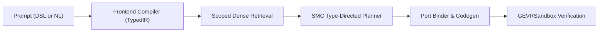
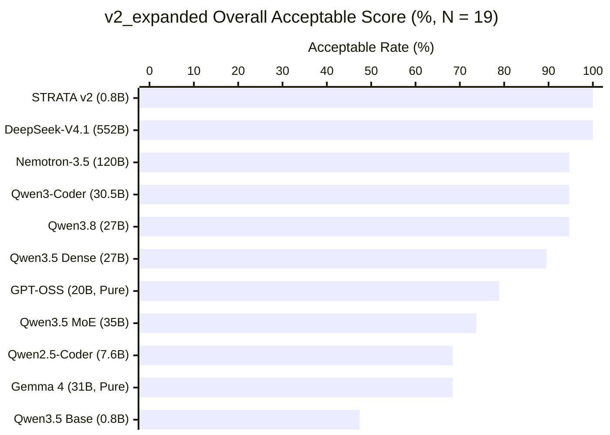
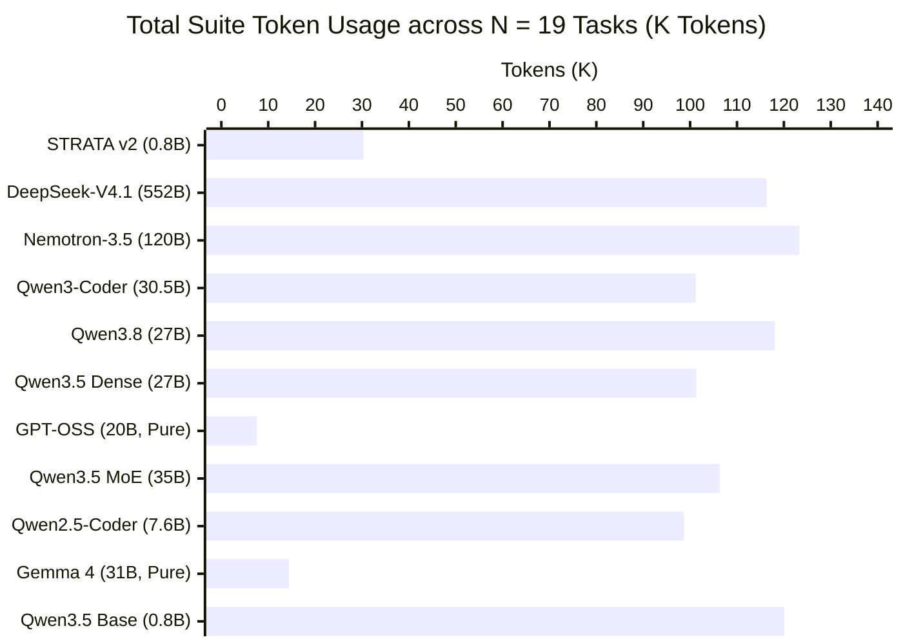
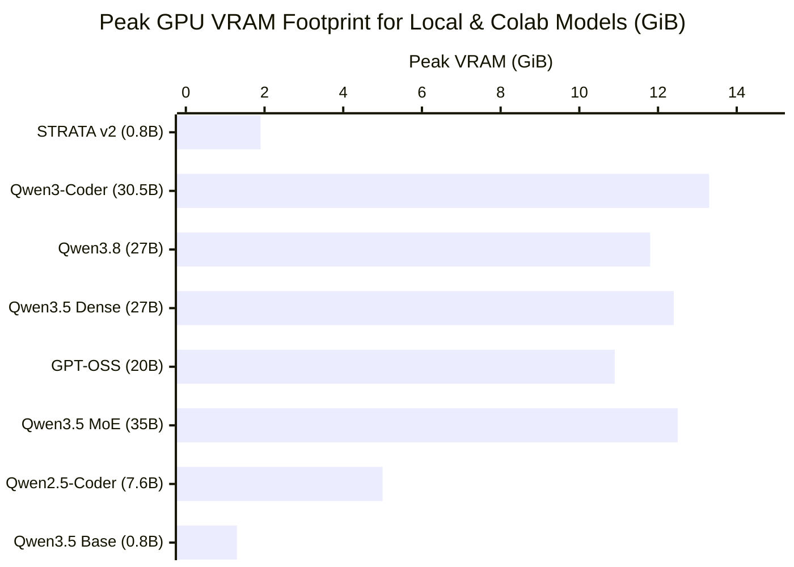

<div align="center">

# STRATA v2

*Type-directed neuro-symbolic program synthesis via a 5-axis graded type system and resource-aware Symmetric Monoidal Category planner.*

[](pyproject.toml)
[](https://github.com/MatthewNader2/STRATA/actions)
[](LICENSE)

[Benchmarks & Task Guide](docs/BENCHMARKS.md) · [Formal Spec](docs/STRATA_FORMAL_SPEC.md) · [Reproducibility](docs/REPRODUCIBILITY.md) · [Models & Profiles](docs/models.md) · [Contributing](CONTRIBUTING.md)

</div>

---

## Overview

**STRATA v2** replaces free-form LLM code guessing with **proof search over typed domain manifests** (`trees/*.json`) paired with a constrained `0.8B` language model (`Qwen3.5-0.8B`). Every library operation declares a 5-axis port contract $\mathcal{T} = \langle \tau, \rho, (\sigma, \mu), \varphi \rangle$ covering carrier subtyping ($\tau$), shape/dtype unification ($\rho$), domain typestate ($\sigma$), numeric refinements ($\varphi$), and linear `acquire`/`borrow`/`release` resource lifetimes ($\mu$).

The kernel (`src/`) contains zero hardcoded library, domain, or model names (enforced by [scripts/check_static.py](scripts/check_static.py)), compiles `15` domain trees (`1,038` typed operations + `22` verified cross-domain bridges) into SQLite v4, and executes synthesized code inside the POSIX-isolated `GEVRSandbox`.



---

## Quick Start

```bash
# Install package + domain dependencies (Python 3.10+)
python3 -m pip install -e ".[domains]" -r requirements.txt

# Optional: download 0.8B GGUF model + nano embedder (~880 MB total)
python3 scripts/download_model.py --tier default

# Compile and validate domain lattice (trees/*.json -> trees/lattice.db)
python3 strata_cli.py compile --clean && python3 strata_cli.py validate && python3 strata_cli.py audit

# Launch interactive studio or run single-shot sandboxed synthesis (Profile O)
python3 strata_cli.py shell
python3 strata_cli.py run --profile O --exec \
  'read image "input.png", convert to grayscale, apply Gaussian blur with kernel size 5 and sigma 1.5, detect Canny edges with threshold1 50 and threshold2 150, and save to "edges.png"'
```

---

## Benchmarks (`v2_expanded`, `N = 19`)

To separate real grounded synthesis from memorized training code, `v2_expanded` (`19` tasks, Seed `42`) tests four distinct capabilities in one matched suite:

- **Actionable Python Pipelines (`8` tasks):** Multi-step workflows across `cv2`, `PIL`, `sqlite3`, `pandas`, and `pygame` verified end-to-end inside `GEVRSandbox`, including implicit edge parameters (`v2_nl_cv2_implicit_params`) and strict adherence to explicit library requests when both `cv2` and `Pillow` are loaded.
- **Blind Synthetic SDKs (`2` tasks):** Fictional `CryoPulse` (`8`-call quantum cryostat sequence) and `Aetheris` (`8`-call optics sequence with deprecated distractor APIs) libraries that do not exist in any LLM's pretraining weights.
- **1K-Noise Haystack (`2` tasks):** Embeds the `11` `CryoPulse` and `15` `Aetheris` target operations inside **1,038 distractor operations** across all 15 repo domains to test long-catalog retrieval and call ordering.
- **Safety & Refusal Guardrails (`7` tasks):** `4` underspecified/asset-missing prompts (where models should ask for clarification instead of guessing code) plus `3` unavailable-library traps (refusing `Pillow` requests when only `cv2` is installed).

> [!NOTE]
> Each row below reports each model's highest-scoring complete `N = 19` run across local RTX 3070 Ti `8 GB`, Colab T4 `15 GB`, and hosted APIs (ties broken by Synthesis accuracy, genuine refusals, lower tokens, and lower latency). Full 19-task prompts, 95% Wilson CIs, `C/D/E/O` ablations, 94-run decoding sensitivity, and `BFCL v3` (`N = 120`) appear in **[docs/BENCHMARKS.md](docs/BENCHMARKS.md)**.



| Model | Params (Active) | Overall (`19`) | Synthesis (`12`) | Safety (`7`) | Tokens | Host · Latency |
| :--- | ---: | ---: | ---: | ---: | ---: | ---: |
| **STRATA v2 (`Profile D`)** | **0.8B** | **19/19 (100.0%)** | **12/12** (`4/4` BH) | **7/7** | **30.3K** | `1.9 GiB` · **8.4s** |
| `DeepSeek-V4.1-Flash` (`SKILL.md`) | 552B (16B) | **19/19 (100.0%)** | **12/12** (`4/4` BH) | **7/7** | 116.3K | Cloud API · 27.4s |
| `Nemotron 3.5 Super VL` (`SKILL.md`) | 120B (12B) | 18/19 (94.7%) | **12/12** (`4/4` BH) | 6/7 | 123.3K | Cloud API · 11.0s |
| `Qwen3-Coder-30B-A3B` (`SKILL.md`) | 30.5B (3.3B) | 18/19 (94.7%) | **12/12** (`4/4` BH) | 6/7 *(3 ref)* | 101.2K | `13.3 GiB` · 11.6s |
| `Qwen3.8-27B` (`SKILL.md`) | 27B | 18/19 (94.7%) | 11/12 (`4/4` BH) | **7/7** | 118.1K | `11.8 GiB` · 149.2s |
| `Qwen3.5-27B Dense` (`SKILL.md`) | 27B | 17/19 (89.5%) | 10/12 (`4/4` BH) | **7/7** | 101.3K | `12.4 GiB` · 38.6s |
| `GPT-OSS-20B` (`Pure`) | 20B (3.6B) | 15/19 (78.9%) | 8/12 (`0/4` BH) | **7/7** | 7.6K | `10.9 GiB` · 3.7s |
| `Qwen3.5-35B-A3B MoE` (`SKILL.md`) | 35B (3B) | 14/19 (73.7%) | 7/12 (`4/4` BH) | **7/7** | 106.3K | `12.5 GiB` · 15.9s |
| `Qwen2.5-Coder-7B` (`SKILL.md`) | 7.6B | 13/19 (68.4%) | 9/12 (`3/4` BH) | 4/7 *(3 ref)* | 98.7K | `5.0 GiB` · 6.2s |
| `Gemma 4 31B IT` (`Pure`) | 30.7B | 13/19 (68.4%) | 8/12 (`0/4` BH) | 5/7 *(4 ref)* | 14.4K | Cloud API · 121.7s |
| `Qwen3.5-0.8B Base` (`Haystack`) | 0.8B | 9/19 (47.4%) | 4/12 (`2/4` BH) | 5/7 *(4 ref)* | 120.1K | `1.3 GiB` · 5.5s |

<details>
<summary><strong>Interactive token usage and GPU VRAM charts (Mermaid)</strong></summary>





</details>

*(Deep-dive tables, 19-task prompts, profile ablations, 94-cell decoding sweep, BFCL v3, and static chart archives: **[docs/BENCHMARKS.md](docs/BENCHMARKS.md)**.)*

---

## Verification & Audits

```bash
python3 -m pytest tests/
python3 test.py --profiles 0 --early-stop   # deterministic 34-case pure symbolic gate (~1s)
python3 scripts/check_static.py            # AST neutrality + undefined-name gate
python3 scripts/lint_trees.py --include-fixtures
python3 scripts/audit_trees.py --strict-five-axis --strict-neutral --include-fixtures
```

## Documentation & Citation

- [docs/BENCHMARKS.md](docs/BENCHMARKS.md) — Interactive task guide, 19 prompts, ablations, decoding sensitivity & BFCL v3.
- [docs/STRATA_FORMAL_SPEC.md](docs/STRATA_FORMAL_SPEC.md) — Type rules, coercion coherence, linear resource discipline & soundness proofs.
- [docs/REPRODUCIBILITY.md](docs/REPRODUCIBILITY.md) — Artifact evaluation, deterministic checks & statistical protocol.
- [docs/development.md](docs/development.md) · [docs/models.md](docs/models.md) · [docs/PEER_REVIEW_TASK_LIST.md](docs/PEER_REVIEW_TASK_LIST.md) · [docs/FUTURE_ROADMAP.md](docs/FUTURE_ROADMAP.md) · [CONTRIBUTING.md](CONTRIBUTING.md)

```bibtex
@software{strata2026,
  author = {Nader, Matthew and Contributors},
  title = {{STRATA}: Symbolic Topological Routing Architecture for Typed Automata},
  year = {2026},
  url = {https://github.com/MatthewNader2/STRATA},
  note = {Category-theoretic neuro-symbolic program synthesis engine}
}
```
