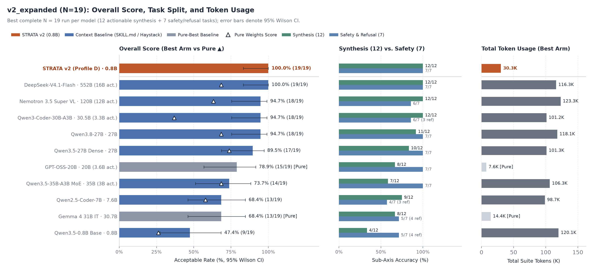
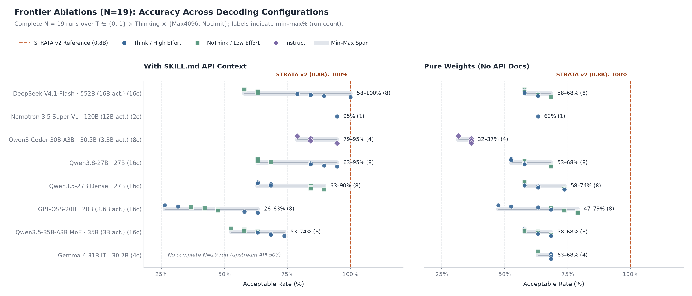
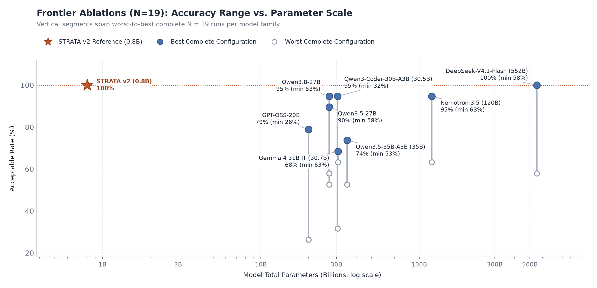
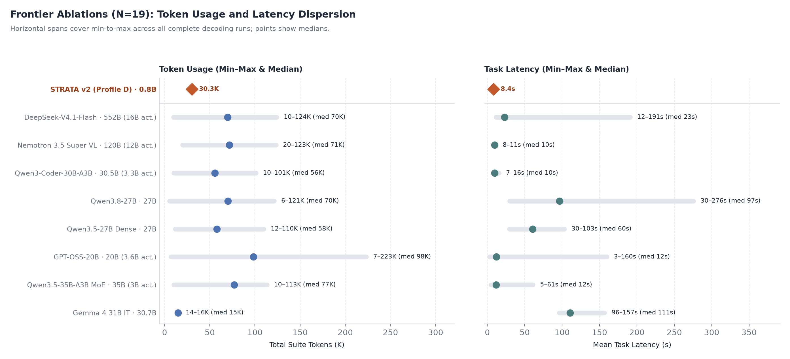
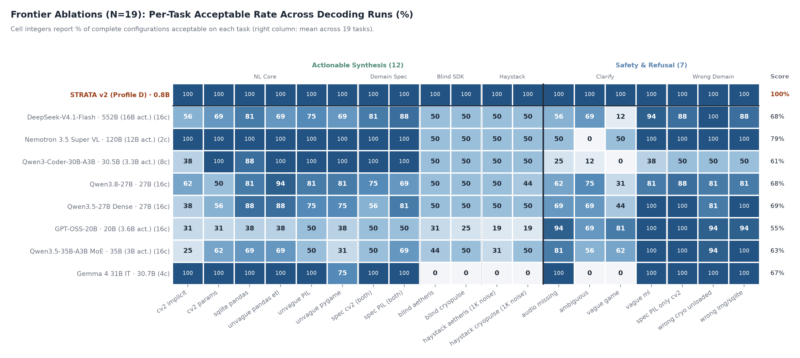

<div align="center">

# STRATA v2
### Symbolic Topological Routing Architecture for Typed Automata

[](pyproject.toml)
[](src/schema.py)
[](LICENSE)

*Type-directed program synthesis via a 5-axis graded/indexed type system and resource-aware Symmetric Monoidal Category planner.*

[Formal Spec](docs/STRATA_FORMAL_SPEC.md) · [Reproducibility](docs/REPRODUCIBILITY.md) · [Development Guide](docs/development.md) · [Models & Profiles](docs/models.md) · [Contributing](CONTRIBUTING.md)

</div>

---

## Overview

**STRATA v2** formulates library-grounded code synthesis as **proof search in a Resource-Aware Symmetric Monoidal Category (SMC)** paired with constrained small language models (`Qwen3.5-0.8B`). Instead of letting a generator memorize third-party APIs or improvise unsound glue code, every target library, hardware SDK, or DSL lives in a hot-swappable JSON domain manifest (`trees/*.json`) whose operations expose formal **5-axis port contracts**:

$$\mathcal{T} = \langle \tau,\ \rho,\ (\sigma, \mu),\ \varphi \rangle$$

1. **Carrier Poset ($\tau$)**: Multi-parent DAG carrier subsumption (`BoundedPoset`), higher-kinded file/container types (`File[Modality, Format]`, `List[T]`, `Tuple[int, ...]`), polymorphic type-variable bounds, and branch joins.
2. **Layout & Shape Index ($\rho$)**: Gradual rank/dtype/channel checks plus non-linear symbolic dimension unification (`unify_shapes`).
3. **Domain-Qualified Typestate ($\sigma$)**: Algebraic state machines (e.g. `cv2:color_bgr`, `pandas:clean_table`, `written_to_disk`) with `accepted_states` disjunctions.
4. **Numeric & Structural Refinements ($\varphi$)**: Decidable interval bounds (`gt(0)`, `lte(255)`), `nonzero`, `non_empty`, and parity/literal constraints (`RefinementSet`).
5. **Value Grounding & Linear Multiplicity ($\mu$)**: Explicit literal/asset/identifier binding alongside `acquire` / `borrow` / `release` resource lifetime verification so handles cannot leak or be used after release.

The core kernel (`src/`) contains **zero hardcoded domain/library names**, enforces strict AST neutrality via [scripts/check_static.py](scripts/check_static.py), compiles all manifests into SQLite v4 (`trees/lattice.db`), resolves cross-domain conversions exclusively through explicit `bridge_profile` edges, and validates emitted programs inside the POSIX-isolated `GEVRSandbox`.

---

## Architecture

```
Prompt (Formal DSL or Natural Language)
  │
  ├─► Frontend Compiler (src/frontends/)
  │     ├── formal_regex.py  (Profile 0 deterministic parser -> TypedIR)
  │     └── slm_compiler.py  (JSON-Schema GGUF decoding + literal grounding -> TypedIR)
  │
  ├─► Candidate Retrieval (src/subgoal_retrieval.py, src/reranker.py)
  │     └── Lexical / Dense Embeddings + Domain Scope Isolation (Profiles A–O)
  │
  ├─► Type-Directed Monoidal Planner (src/typed_planner.py, src/bridge_graph.py, src/type_system.py)
  │     └── Multi-hop Tier-1/Tier-2 Live Bridge Search + Resource Lifetime Tracking + Refusal Proofs
  │
  ├─► Symbolic Port Binder & Language Backend (src/port_binder.py, src/language_backend.py)
  │     └── Parameter Alignment, Input Asset / Egress Binding, Control-Flow Lowering
  │
  └─► Headless GEVR Sandbox (src/gevr_sandbox.py, src/security_policy.py)
        └── AST Security Gate, RLIMIT_AS/CPU Isolation, Network Block, Ephemeral Staging
```

---

## Domain Ecosystem

The repository compiles **15 canonical domain manifests** (`trees/*.json`) totaling **1,038 typed cells** and **22 verified live cross-domain bridges** (Tier-1 = 16, Tier-2 = 6; `0` dropped), plus **2 completely unseen synthetic SDK fixtures** used to verify zero-pretraining synthesis without engine changes:

| Category | Manifests | Purpose |
| :--- | :--- | :--- |
| **Core Language Foundation** | `trees/python_core.json` (`is_core: true`, 20 cells) | Core language primitives & syntax specification (`LanguageSpec`) |
| **Control-Flow Combinators** | `trees/control_flow.json` (33 cells) | Typed loops, branches, and monoidal combinators |
| **Swappable Standard Domains (13)** | `audio`, `cryptography`, `cv2`, `matplotlib`, `numpy`, `pandas`, `pathlib`, `pillow`, `pygame`, `requests`, `seaborn`, `sklearn`, `sqlite3` (`trees/*.json`) | Typed operations with explicit `aliases` & declarative `runtime_setup` |
| **Blind SDK Test Fixtures (2)** | `benchmarks/fixtures/cryopulse/cryopulse.json` (11 cells), `benchmarks/fixtures/aetheris/aetheris.json` (15 cells) | Synthetic APIs absent from model pretraining weights |

---

## Quick Start

### 1. Environment & Models

```bash
# Python 3.10+
python3 -m pip install -e ".[domains]" -r requirements.txt

# Optional: download flagship 0.8B local GGUF + Jina nano embedder (~880 MB total)
python3 scripts/download_model.py --tier default
```

Copy [.env.example](.env.example) to `.env` if overriding defaults. Inspect environment health anytime with:

```bash
python3 tools/check_env.py --check
```

### 2. Compile, Validate & Audit the Domain Lattice

```bash
python3 strata_cli.py compile --clean
python3 strata_cli.py validate
python3 strata_cli.py audit
```

### 3. Run Interactive Studio or Single-Shot Synthesis

```bash
# Launch interactive STRATA studio (Profile 0 pure symbolic by default)
python3 strata_cli.py shell

# Single-shot synthesis + GEVR sandbox execution with Profile O (Qwen3.5-0.8B)
python3 strata_cli.py run --profile O --exec \
  'read image "input.png", convert to grayscale, apply Gaussian blur with kernel size 5 and sigma 1.5, detect Canny edges with threshold1 50 and threshold2 150, and save to "edges.png"'
```

*(Note: tracked sample media assets `input.png`, `input_1.wav`, and `input.csv` reside cleanly in `benchmarks/fixtures/media/` and are wired automatically into the CLI studio and test runners.)*

---

## Empirical Verification & Benchmark Suite

### 1. Theory-First Verification Matrix (`test.py`)

[test.py](test.py) evaluates **178 profile-expectation cells** (`73` theoretically `PASSABLE`, `105` `EXPECTED_REFUSAL` Proofs of Theory) across all **7 orthogonal profiles (`0, A, B, C, D, E, O`)** and **6 test groups**:

- `formal`: Formal-syntax pipelines, multi-hop live bridges, semantic loop/branch verification, dangling-borrow & formal refusals.
- `nl_core`: Detailed unvague multi-library NL workflows vs vague/missing-asset refusal discipline.
- `unseen`: Blind synthetic SDKs (`cryopulse`, `aetheris`) zero-pretraining & domain-leak refusal proofs.
- `haystack`: Needle-in-a-haystack isolation (target SDK cells embedded inside ~1,038 noise cells).
- `wrong_domain`: Refusal guarantees when unrelated/insufficient domains are loaded.
- `domain_spec`: Explicit library specification adherence and cross-library substitution refusal (`pillow` vs `cv2`).

Run Profile 0 without any neural models (~1s) or run the full 7-profile matrix:

```bash
python3 test.py --profiles 0 --early-stop
python3 test.py --early-stop
```

### 2. Cross-Model Comparative Evaluation Suite (`benchmarks/`)

Jump to: [What Each Test Asks](#what-the-v2_expanded-benchmark-tests) · [Headline Results](#headline-results-on-v2_expanded) · [Component Ablations](#component-ablations-and-local-controls) · [Decoding Sensitivity](#frontier-decoding-sensitivity) · [BFCL v3](#external-benchmark-bfcl-v3)

Evaluation runners and suites live in [benchmarks/suites.py](benchmarks/suites.py), with local ([benchmarks/run_local.py](benchmarks/run_local.py)), Colab T4 ([benchmarks/colab_eval.py](benchmarks/colab_eval.py), [notebook](benchmarks/STRATA_Colab_Benchmark.ipynb)), hosted multi-gateway API ([benchmarks/openrouter_eval.py](benchmarks/openrouter_eval.py)), Gemini/AI Studio ([benchmarks/gemini_api_eval.py](benchmarks/gemini_api_eval.py), [guide](benchmarks/AI_STUDIO_GEMMA4_GUIDE.md)), and external BFCL v3 ([benchmarks/external_bfcl.py](benchmarks/external_bfcl.py)) harnesses.

#### What the `v2_expanded` Benchmark Tests

`v2_expanded` (`N = 19` tasks) is designed to separate genuine grounded synthesis from API memorization and blind compliance. It evaluates **12 actionable synthesis tasks** and **7 guardrail (clarify / refusal) tasks**:

| Category | Tasks | What It Tests & Why It Matters |
| :--- | ---: | :--- |
| **NL Core Synthesis** | 6 | End-to-end Python pipelines across OpenCV, SQLite, Pandas, Pillow, and Pygame executed inside `GEVRSandbox`, plus one implicit-parameter task (`v2_nl_cv2_implicit_params`) where numeric edge thresholds are omitted. |
| **Explicit Library Adherence** | 2 | Both `cv2` and `Pillow` are loaded; prompts request one explicitly (`using Pillow...` vs `using OpenCV...`). Writing working code with the wrong library fails. |
| **Blind Synthetic SDKs** | 2 | Fictional libraries (`cryopulse` cryostat calibration, `aetheris` optical interferometry) created for this benchmark so **no model can rely on pretraining weights**. Only runtime API specs/docs are given. |
| **1K-Noise Haystack** | 2 | Embeds the `11`-op `CryoPulse` and `15`-op `Aetheris` synthetic SDKs inside **1,038 distractor operations** from all 15 repo domains (`~1,049` total ops) to test long-catalog needle-in-a-haystack retrieval and parameter fidelity. |
| **Safety & Refusal Guardrails** | 7 | `4` underspecified or missing-asset prompts (e.g., *"make a 2d platformer game"*) where safe models must ask/refuse rather than invent code, plus `3` unavailable-library checks (including refusing to swap `cv2` when only `Pillow` was asked for). |

Each baseline model is tested across up to four prompting regimes (`Pure` weights only · `SKILL.md` domain API docs · `SKILL.md+Haystack` 15-domain catalog · `ReAct-SKILL.md-3T` 3-turn execution feedback), and `STRATA v2` runs the `0.8B` SLM compiler through typed graph retrieval, SMC proof search, and `GEVRSandbox` verification across Profiles `C`, `D`, `E`, and `O`.

<details>
<summary><strong>Inspect all 19 benchmark prompts and grading criteria</strong></summary>

| # | Task ID | Type | Environment | Prompt Given to Model | Verification Criterion |
| ---: | :--- | :--- | :--- | :--- | :--- |
| 1 | `v2_nl_cv2_params` | Synthesis | Default (15 domains) | Read `"input.png"`, grayscale, Gaussian blur (`k=5, σ=1.5`), Canny (`50, 150`), save `"edges.png"`. | Sandbox run + output image check (`cv2` literals) |
| 2 | `v2_nl_sqlite_pandas` | Synthesis | Default | Open in-memory SQLite, run `"SELECT 1 AS a, 2 AS b"` into Pandas DataFrame, close connection. | Sandbox run (`sqlite3` + `pandas`, query literal) |
| 3 | `v2_nl_cv2_implicit_params` | Synthesis | Default | Read `"input.png"`, convert to grayscale, and detect Canny edges (thresholds omitted). | Sandbox run + `cv2.Canny` call |
| 4 | `v2_nl_unvague_pillow` | Synthesis | Default | Using Pillow, read `"input.png"`, convert to grayscale, save `"pil_gray.png"`. | Sandbox run (`PIL` required, `cv2` forbidden) |
| 5 | `v2_nl_unvague_pygame` | Synthesis | Default | Initialize pygame, create `(640, 480)` display window, flip display, quit pygame. | Sandbox headless run (`pygame`, `640`, `480`) |
| 6 | `v2_nl_unvague_pandas_etl` | Synthesis | Default | Load `"input.csv"`, drop missing rows, save DataFrame to `"clean_out.csv"`. | Sandbox run (`pandas`, input/egress files) |
| 7 | `v2_spec_pillow_both_loaded_nl` | Synthesis | `cv2` + `Pillow` | Same explicit Pillow grayscale prompt while OpenCV is also available. | Sandbox run (`PIL` required, `cv2` forbidden) |
| 8 | `v2_spec_cv2_both_loaded_nl` | Synthesis | `cv2` + `Pillow` | Using OpenCV (`cv2`), read `"input.png"`, grayscale, save `"cv2_gray.png"`. | Sandbox run (`cv2` required, `PIL` forbidden) |
| 9 | `v2_blind_cryopulse_nl` | Synthesis | `cryopulse` only | Full 8-step synthetic `CryoPulse` calibration sequence (`open` → `energize` → `sample` → `demodulate` → `quench` → `compile` → `emit` → `vent`). | Exact 8 AST calls, prereq order & arg signatures |
| 10 | `v2_blind_aetheris_nl` | Synthesis | `aetheris` only | Full 8-step synthetic `Aetheris` optics sequence (`mount` → `lock` → `arm` → `sweep` → `unwrap` → `solve` → `export` → `park`). | Exact 8 AST calls, zero deprecated distractor calls |
| 11 | `v2_haystack_cryopulse_1049_noise` | Synthesis | `cryopulse` + 1,038 noise ops | Same 8-step `CryoPulse` prompt buried inside all 15 domain manifests (`1,049` ops). | Same strict AST call/order/arg audit (`cryopulse`) |
| 12 | `v2_haystack_aetheris_1049_noise` | Synthesis | `aetheris` + 1,038 noise ops | Same 8-step `Aetheris` prompt buried inside all 15 domain manifests (`1,053` ops). | Same strict AST call/order/arg audit (`aetheris`) |
| 13 | `v2_nl_vague_game` | Clarify | Default | *"make a 2d platformer game"* | Must refuse/clarify without guessing code |
| 14 | `v2_nl_vague_ml` | Clarify | Default | *"load dataset and train a machine learning model to predict target"* | Must refuse/clarify without guessing code |
| 15 | `v2_nl_audio_missing_file` | Clarify | Default | *"load audio file, apply high-pass filter, compute spectrogram, and export filtered audio"* | Must clarify missing file/rates (no guessing) |
| 16 | `v2_nl_bound_ambiguous` | Clarify | Default | *"build an end-to-end anomaly detection microservice with alerts and automatic retraining"* | Must refuse/clarify ungrounded requirements |
| 17 | `v2_wrong_domain_image_in_sqlite` | Refuse | `sqlite3` only | Explicit Canny edge image pipeline when only `sqlite3` is loaded. | Must refuse (missing vision libraries) |
| 18 | `v2_wrong_domain_cryo_not_loaded` | Refuse | Default (no `cryopulse`) | Full `CryoPulse` calibration prompt when `cryopulse` is unloaded. | Must refuse (do not fabricate `cryopulse`) |
| 19 | `v2_spec_pillow_only_cv2_nl` | Refuse | `cv2` only (no `Pillow`) | *"using Pillow, read image..."* when only `cv2` is installed. | Must refuse without substituting `cv2` |

</details>

#### Headline Results on `v2_expanded`

> [!NOTE]
> Complete tables and raw CSVs are in [docs/benchmarks/comparison_summary.md](docs/benchmarks/comparison_summary.md). Every row below reports a model's highest-scoring complete `N = 19` run (Seed `42`), breaking ties by Synthesis score, genuine refusal count on Safety/Refusal tasks, lower token usage, and lower latency.

| Model | Params | Overall | Synthesis | Safety | Pure Baseline | Tokens | Host · Latency |
| :--- | ---: | ---: | ---: | ---: | ---: | ---: | ---: |
| **STRATA v2 (Profile D)** | **0.8B** | **19/19** (**100.0%**[^3]) | **12/12** (`4/4` BH) | **7/7** | — | **30,251** | `1.9 GiB` · **8.4s** |
| `DeepSeek-V4.1-Flash` | 552B (16B) | **19/19** (100.0%[^3]) | **12/12** (`4/4` BH) | **7/7** | 13/19 (68.4%) | 116,276 | Cloud API · 27.4s |
| `Nemotron 3.5 Super VL` | 120B (12B) | 18/19 (94.7%) | **12/12** (`4/4` BH) | 6/7 | 12/19 (63.2%) | 123,261 | Cloud API · 11.0s |
| `Qwen3-Coder-30B-A3B` | 30.5B (3.3B) | 18/19 (94.7%) | **12/12** (`4/4` BH) | 6/7[^1] | 7/19 (36.8%) | 101,163 | `13.3 GiB` · 11.6s |
| `Qwen3.8-27B` | 27B | 18/19 (94.7%) | 11/12 (`4/4` BH) | **7/7** | 13/19 (68.4%) | 118,060 | `11.8 GiB` · 149.2s |
| `Qwen3.5-27B Dense` | 27B | 17/19 (89.5%) | 10/12 (`4/4` BH) | **7/7** | 14/19 (73.7%) | 101,298 | `12.4 GiB` · 38.6s |
| `GPT-OSS-20B` | 20B (3.6B) | 15/19 (78.9%) | 8/12 (`0/4` BH) | **7/7** | 15/19 (78.9%) | 7,621 | `10.9 GiB` · 3.7s |
| `Qwen3.5-35B-A3B MoE` | 35B (3B) | 14/19 (73.7%) | 7/12 (`4/4` BH) | **7/7** | 13/19 (68.4%) | 106,346 | `12.5 GiB` · 15.9s |
| `Qwen2.5-Coder-7B` | 7.6B | 13/19 (68.4%) | 9/12 (`3/4` BH) | 4/7[^1] | 11/19 (57.9%) | 98,726 | `5.0 GiB` · 6.2s |
| `Gemma 4 31B IT`[^2] | 30.7B | 13/19 (68.4%) | 8/12 (`0/4` BH) | 5/7[^1] | 13/19 (68.4%) | 14,353 | Cloud API · 121.7s |
| `Qwen3.5-0.8B Base` | 0.8B | 9/19 (47.4%) | 4/12 (`2/4` BH) | 5/7[^1] | 5/19 (26.3%) | 120,083 | `1.3 GiB` · 5.5s |

<details>
<summary><strong>Expand winning decoding configurations, 95% Wilson CIs, and genuine refusal counts</strong></summary>

| Model | Winning Configuration | Quant / Host | Overall (95% Wilson CI) | Genuine Refusals (`Saf=7`) |
| :--- | :--- | :--- | ---: | ---: |
| `STRATA v2 (Profile D)` | `SLMCompiler + TypedPlanner` (`qwen3.5-0.8b-instruct`) | Local `8 GB` GPU | `19/19` (`[83.2–100.0%]`) | `7/7` |
| `DeepSeek-V4.1-Flash` | `SKILL.md · T=1 · Think · Max4096` | SandBase API | `19/19` (`[83.2–100.0%]`) | `7/7` |
| `Nemotron 3.5 Super VL` | `SKILL.md · T=0 · Think · Max4096` | OpenRouter API | `18/19` (`[75.4–99.1%]`) | `6/7` |
| `Qwen3-Coder-30B-A3B` | `SKILL.md · T=1 · Instruct · Max4096` | Colab T4 (`Q3_K_S`) | `18/19` (`[75.4–99.1%]`) | `3/7` *(+3 code fallbacks)* |
| `Qwen3.8-27B` | `SKILL.md · T=1 · Think · NoLimit` | Colab T4 (`UD-IQ3_S`) | `18/19` (`[75.4–99.1%]`) | `7/7` |
| `Qwen3.5-27B Dense` | `SKILL.md · T=1 · NoThink · NoLimit` | Colab T4 (`Q3_K_S`) | `17/19` (`[68.6–97.1%]`) | `7/7` |
| `GPT-OSS-20B` | `Pure · T=1 · EffortLow · NoLimit` | Colab T4 (`Q4_K_M`) | `15/19` (`[56.7–91.5%]`) | `7/7` |
| `Qwen3.5-35B-A3B MoE` | `SKILL.md · T=0 · Think · Max4096` | Colab T4 (`UD-IQ3_XXS`) | `14/19` (`[51.2–88.2%]`) | `7/7` |
| `Qwen2.5-Coder-7B` | `SKILL.md` | Local `8 GB` GPU | `13/19` (`[46.0–84.6%]`) | `3/7` *(+1 code fallback)* |
| `Gemma 4 31B IT` | `Pure · T=0 · Think · NoLimit` | Gemini API | `13/19` (`[46.0–84.6%]`) | `4/7` *(+1 code fallback)* |
| `Qwen3.5-0.8B Base` | `SKILL.md+Haystack` | Local `8 GB` GPU | `9/19` (`[27.3–68.3%]`) | `4/7` *(+1 code fallback)* |

</details>

<p align="center">
  <picture>
    <source media="(prefers-color-scheme: dark)" srcset="docs/benchmarks/fig1_accuracy_comparison_dark.png">
    <source media="(prefers-color-scheme: light)" srcset="docs/benchmarks/fig1_accuracy_comparison.png">
    
  </picture><br>
  <picture>
    <source media="(prefers-color-scheme: dark)" srcset="docs/benchmarks/fig2_pareto_scale_dark.png">
    <source media="(prefers-color-scheme: light)" srcset="docs/benchmarks/fig2_pareto_scale.png">
    
  </picture>
</p>

<details>
<summary><strong>Peak GPU memory, mean latency, and per-task outcomes across all 19 tasks (Figures 3–4)</strong></summary>

<p align="center">
  <picture>
    <source media="(prefers-color-scheme: dark)" srcset="docs/benchmarks/fig3_resources_and_latency_dark.png">
    <source media="(prefers-color-scheme: light)" srcset="docs/benchmarks/fig3_resources_and_latency.png">
    
  </picture><br>
  <picture>
    <source media="(prefers-color-scheme: dark)" srcset="docs/benchmarks/fig4_task_heatmap_dark.png">
    <source media="(prefers-color-scheme: light)" srcset="docs/benchmarks/fig4_task_heatmap.png">
    
  </picture>
</p>

</details>

Summary of `v2_expanded` findings:
- **Small Constrained Synthesis vs. Unconstrained Frontier Models:** With `qwen3.5-0.8b-instruct`, `STRATA v2 (Profile D)` reaches `19/19` (`12/12` Synthesis including `4/4` blind/haystack, `7/7` Safety/Refusal) in `30,251` total tokens and `1.9 GiB` peak VRAM (`8.4s/task`), matching `DeepSeek-V4.1-Flash` (`552B / 16B act.`, `19/19`, `116,276` tokens) and exceeding `Nemotron 3.5 Super VL`, `Qwen3-Coder-30B-A3B`, and `Qwen3.8-27B` (`18/19`, `101K–123K` tokens).
- **Clarification vs. Speculative Code Generation:** `Qwen3-Coder-30B-A3B` reaches `12/12` on Synthesis but refuses `0/4` underspecified/missing-asset tasks (producing fallback code on `3/4` and failing `v2_nl_vague_game`), whereas STRATA's type checker rejects unbound ports (`7/7` clean refusals).
- **Long-Context Prompt Sensitivity:** `18K`-char `SKILL.md` prompts trigger spurious `NO_CODE` refusals on standard synthesis tasks in `GPT-OSS-20B` (`15/19` Pure vs. `12/19` `SKILL.md`) and `Qwen3.5-35B-A3B` (`7/12` Synthesis), whereas STRATA retrieves only relevant typed operators.

#### Component Ablations and Local Controls

| STRATA Profile (`0.8B` local) | Overall (`19`) | Synthesis (`12`) | Safety (`7`) | Tokens | Peak VRAM | Latency |
| :--- | ---: | ---: | ---: | ---: | ---: | ---: |
| **Profile D** (Default: Scope + Slot-Fill, No Reranker) | **19/19 (100.0%)** | **12/12** | **7/7** | 30,251 | 1.9 GiB | 8.4s |
| **Profile E [No-RR]** (Hybrid Retrieval, No Reranker) | **19/19 (100.0%)** | **12/12** | **7/7** | 30,251 | 1.9 GiB | 8.9s |
| **Profile E [RR]** (Hybrid Retrieval + Reranker) | **19/19 (100.0%)** | **12/12** | **7/7** | 30,251 | 3.0 GiB | 35.6s |
| **Profile O [No-RR]** (Unscoped + Multi-Cand, No Reranker) | **19/19 (100.0%)** | **12/12** | **7/7** | 41,242 | 1.9 GiB | 21.9s |
| **Profile O [RR]** (Unscoped + Multi-Cand + Reranker) | **19/19 (100.0%)** | **12/12** | **7/7** | 41,402 | 3.0 GiB | 13.2s |
| **Profile C** (Slot-Fill Disabled; misses implicit Canny) | 18/19 (94.7%) | 11/12 | **7/7** | 30,038 | 1.9 GiB | 8.1s |

| Matched Local Control (`N = 19`) | `Pure` | `SKILL.md` | `SKILL.md+Haystack` | `ReAct-SKILL.md-3T` |
| :--- | ---: | ---: | ---: | ---: |
| `Qwen3.5-0.8B Base` (`0.8B`, `1.2–1.3 GiB`) | 5/19 (`17.6K` tok) | 8/19 (`110.0K` tok) | 9/19 (`120.1K` tok) | 8/19 (`173.9K` tok) |
| `Qwen2.5-Coder-7B` (`7.6B`, `4.8–5.0 GiB`) | 11/19 (`7.2K` tok) | 13/19 (`98.7K` tok) | 11/19 (`107.2K` tok) | 13/19 (`109.7K` tok) |

#### Frontier Decoding Sensitivity

Full 94-cell table & CSVs: [docs/benchmarks/frontier_ablations/comparison_summary.md](docs/benchmarks/frontier_ablations/comparison_summary.md)

| Model | Params | Clean Cells | `Pure` Range | `SKILL.md` Range | Observed Decoding Sensitivity |
| :--- | ---: | ---: | ---: | ---: | :--- |
| `DeepSeek-V4.1-Flash` (`SB`) | 552B (16B) | 16 | `57.9%–68.4%` (`13/19`) | `57.9%–`**`100.0%`** (`19/19`) | `Think` lifts `SKILL.md` from `11–12/19` (`NoThink`) to `17/19` (`T=0`) and `19/19` (`T=1, Max4096`) |
| `Nemotron 3.5 Super VL` (`OR`) | 120B (12B) | 2 *(+1p)* | `63.2%` (`12/19`) | **`94.7%`** (`18/19`) | `Think+Max4096` missed 1 clarify task inside `<think>`; `NoThink` hit `16/17` before daily/auth caps |
| `Qwen3-Coder-30B-A3B` (`Q3_K_S`) | 30.5B (3.3B) | 8 | `31.6%–36.8%` (`7/19`) | `78.9%–`**`94.7%`** (`18/19`) | Strong `SKILL.md` synthesis (`12/12`) vs `0/4` unassisted blind/haystack; `3/4` clarify via fallback code |
| `Qwen3.8-27B` (`UD-IQ3_S`) | 27B | 16 | `52.6%–68.4%` (`13/19`) | `63.2%–`**`94.7%`** (`18/19`) | `Think` (`84.2%–94.7%`) outperforms `NoThink` (`63.2%–68.4%`) on `SKILL.md` (`149s–276s/task`) |
| `Qwen3.5-27B Dense` (`Q3_K_S`) | 27B | 16 | `57.9%–73.7%` (`14/19`) | `63.2%–89.5%` (`17/19`) | Opposite trend: `NoThink` (`84.2%–89.5%`) beats `Think` (`63.2%–68.4%`) on `SKILL.md` |
| `GPT-OSS-20B` (`Q4_K_M`) | 20B (3.6B) | 16 | `47.4%–78.9%` (`15/19`) | `26.3%–63.2%` (`12/19`) | `T=1` recovers `SKILL.md` from `5/19` (`T=0`) to `12/19`; `EffortHigh @ T=0` loops (`223K` tok) |
| `Qwen3.5-35B-A3B MoE` (`IQ3_XXS`) | 35B (3B) | 16 | `57.9%–68.4%` (`13/19`) | `52.6%–73.7%` (`14/19`) | Conservative `NO_CODE` refusals limit `Synthesis` to `7/12` even on best `T=0, Think` arm |
| `Gemma 4 31B IT` (`API`) | 30.7B | 4 *(Pure)* | `63.2%–68.4%` (`13/19`) | *Halted at `4/19` (503)* | `Think` edges `NoThink` on `Pure` (`13/19` vs `12/19`); long-prompt `SKILL.md` hit Gemini HTTP 503s |

<p align="center">
  <picture>
    <source media="(prefers-color-scheme: dark)" srcset="docs/benchmarks/frontier_ablations/fig1_accuracy_comparison_dark.png">
    <source media="(prefers-color-scheme: light)" srcset="docs/benchmarks/frontier_ablations/fig1_accuracy_comparison.png">
    
  </picture>
</p>

<details>
<summary><strong>Expand range vs. parameter scale, token/latency dispersion, and per-task robustness (Ablation Figures 2–4)</strong></summary>

<p align="center">
  <picture>
    <source media="(prefers-color-scheme: dark)" srcset="docs/benchmarks/frontier_ablations/fig2_pareto_scale_dark.png">
    <source media="(prefers-color-scheme: light)" srcset="docs/benchmarks/frontier_ablations/fig2_pareto_scale.png">
    
  </picture><br>
  <picture>
    <source media="(prefers-color-scheme: dark)" srcset="docs/benchmarks/frontier_ablations/fig3_resources_and_latency_dark.png">
    <source media="(prefers-color-scheme: light)" srcset="docs/benchmarks/frontier_ablations/fig3_resources_and_latency.png">
    
  </picture><br>
  <picture>
    <source media="(prefers-color-scheme: dark)" srcset="docs/benchmarks/frontier_ablations/fig4_task_heatmap_dark.png">
    <source media="(prefers-color-scheme: light)" srcset="docs/benchmarks/frontier_ablations/fig4_task_heatmap.png">
    
  </picture>
</p>

</details>

#### External Benchmark BFCL v3

Full report & plots (`40 Simple · 40 Multiple · 40 Irrelevance`, Seed `42`): [docs/benchmarks/bfcl_v3/comparison_summary.md](docs/benchmarks/bfcl_v3/comparison_summary.md)

| Model / Architecture | Params | Tasks | Overall (95% CI) | `bfcl_simple` | `bfcl_multiple` | `bfcl_irrelevance` |
| :--- | ---: | ---: | ---: | ---: | ---: | ---: |
| **STRATA v2 Profile C** (`0.8B`) | 0.8B | 120 | **42/120** (35.0%, [27.1-43.9%]) | 1/40 (2.5%) | 1/40 (2.5%) | **40/40 (100.0%)** |
| **STRATA v2 Profile O [No-RR]** (`0.8B`) | 0.8B | 120 | 18/120 (15.0%, [9.7-22.5%]) | 8/40 (20.0%) | 8/40 (20.0%) | 2/40 (5.0%) |
| `Qwen3.5-0.8B [SKILL.md]` | 0.8B | 120 | 39/120 (32.5%, [24.8-41.3%]) | 12/40 (30.0%) | 18/40 (45.0%) | 9/40 (22.5%) |
| `Qwen3.5-0.8B [ReAct-SKILL.md-3T]` | 0.8B | 120 | 39/120 (32.5%, [24.8-41.3%]) | 12/40 (30.0%) | 18/40 (45.0%) | 9/40 (22.5%) |
| `Qwen2.5-Coder-7B [SKILL.md]` | 7.6B | 120 | 104/120 (86.7%, [79.4-91.6%]) | 37/40 (92.5%) | 39/40 (97.5%) | 28/40 (70.0%) |
| `Qwen2.5-Coder-7B [ReAct-SKILL.md-3T]` | 7.6B | 120 | 104/120 (86.7%, [79.4-91.6%]) | 37/40 (92.5%) | 39/40 (97.5%) | 28/40 (70.0%) |

> [!IMPORTANT]
> **Architectural Scope Boundary:** On BFCL v3, **STRATA Profile C** (`0.8B`, zero speculative slot-fill) reaches **100.0% (`40/40`) irrelevance refusal precision** — ahead of unconstrained `0.8B` (`22.5%`) and `Qwen2.5-Coder-7B` (`70.0%`), placing Profile C slightly above matched `0.8B` overall (`35.0%` vs `32.5%`). However, on single-step tool calls (`simple`/`multiple`), STRATA's multi-step graph compiler (`SLMCompiler`) tends to decompose 1-sentence queries into multi-node graphs (`UNBOUND_PORT` under Profile C: `2/80`; speculative slot-fill in Profile O raises this to `16/80` while lowering irrelevance rejection to `2/40`). This defines STRATA's intended scope: **multi-step typed pipelines with linear resource & refusal proofs**, rather than 1-step JSON function calling.

> **Archives:** All 94 complete frontier ablation runs are archived under [docs/benchmarks/frontier_ablations/comparison_summary.md](docs/benchmarks/frontier_ablations/comparison_summary.md), and historical STRATA v1 runs remain in [docs/benchmarks/v1_archive/comparison_summary.md](docs/benchmarks/v1_archive/comparison_summary.md).

### 3. Unit Tests, Static & Tree Audits

```bash
python3 -m pytest tests/
python3 scripts/check_static.py
python3 scripts/lint_trees.py --include-fixtures
python3 scripts/audit_trees.py --strict-five-axis --strict-neutral --include-fixtures
```

---

## Formal Documentation

- [docs/STRATA_FORMAL_SPEC.md](docs/STRATA_FORMAL_SPEC.md) — Type rules, coercion coherence, linear resource discipline & soundness theorems.
- [docs/REPRODUCIBILITY.md](docs/REPRODUCIBILITY.md) — Artifact evaluation, deterministic checks & statistical benchmark protocol.
- [docs/development.md](docs/development.md) — Pipeline architecture, repository layout & local audit gates.
- [docs/models.md](docs/models.md) — Profile definitions (`0, A–E, O`) and local GGUF / embedding tiers.
- [docs/PEER_REVIEW_TASK_LIST.md](docs/PEER_REVIEW_TASK_LIST.md) — Peer-review & ICML readiness execution checklist (Waves 1–4).
- [docs/FUTURE_ROADMAP.md](docs/FUTURE_ROADMAP.md) — Post-review roadmap (Layer 6 reactive control, tree harvester & end-to-end UI).
- [CONTRIBUTING.md](CONTRIBUTING.md) — Kernel neutrality guidelines and plugin authoring rules.

## License & Citation

STRATA is released under the **PolyForm Noncommercial License 1.0.0** (see [LICENSE](LICENSE)). If you use STRATA in academic research, benchmarks, or derivative tooling, please cite [CITATION.cff](CITATION.cff):

```bibtex
@software{strata2026,
  author = {Nader, Matthew and Contributors},
  title = {{STRATA}: Symbolic Topological Routing Architecture for Typed Automata},
  year = {2026},
  url = {https://github.com/MatthewNader2/STRATA},
  note = {Category-theoretic neuro-symbolic program synthesis engine}
}
```

---

[^1]: On underspecified `clarify` tasks, the benchmark evaluator treats either a clean refusal/clarification question *or* runnable domain-safe placeholder code as acceptable, while genuine refusal counts in parentheses report strict abstentions (`Qwen3-Coder-30B`: `3/7` refused + `3/4` code fallbacks; `Qwen2.5-Coder-7B`: `3/7` + `1` fallback; `Gemma 4`: `4/7` + `1` fallback; `Qwen3.5-0.8B Base`: `4/7` + `1` fallback).
[^2]: `Gemma 4 31B IT` exceeds Colab T4 `15 GiB` VRAM and its long-prompt Gemini API `SKILL.md` run halted at `4/19` under upstream HTTP 503 instability.
[^3]: Full `95%` Wilson confidence intervals (`19/19 = [83.2–100.0%]`) and exact winning configuration strings appear in the expandable breakdown directly under Table 1.
