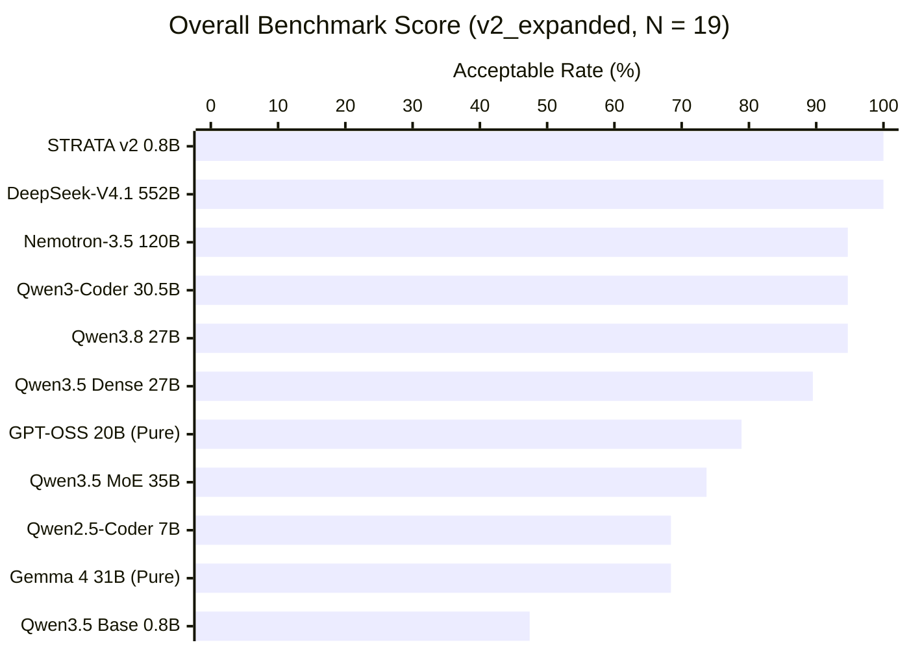
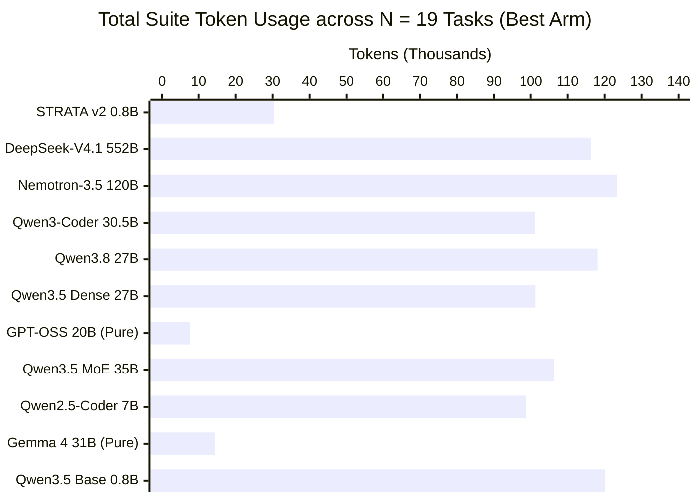
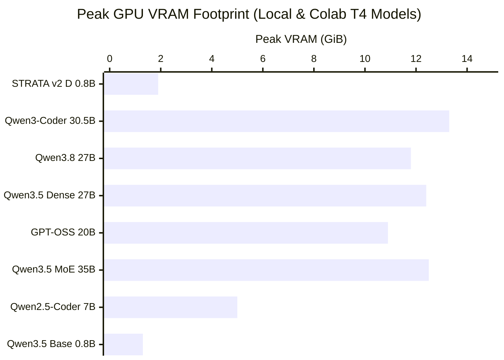
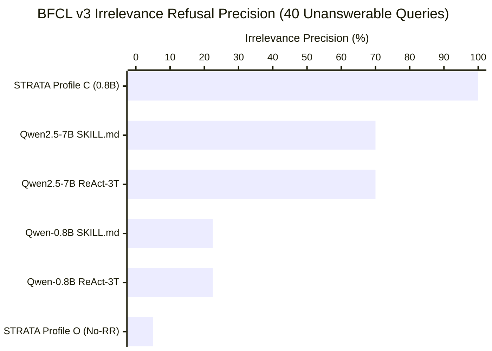

# STRATA v2 Benchmarks & Evaluation Guide

Complete methodology, task prompts, interactive charts, confidence intervals, component ablations, frontier decoding sensitivity (`94` runs), and external BFCL v3 comparison for **STRATA v2**.

Jump to: [What `v2_expanded` Tests](#what-the-v2_expanded-benchmark-tests) · [19 Task Prompts](#all-19-task-prompts--grading-criteria) · [Headline Results](#headline-results-v2_expanded-n--19) · [Profile & Local Ablations](#strata-profile-ablations--matched-local-controls) · [Frontier Decoding Sensitivity](#frontier-decoding-sensitivity-94-complete-runs) · [BFCL v3](#external-public-benchmark-bfcl-v3-n--120) · [Reproducibility](#reproduce-locally)

---

## What the `v2_expanded` Benchmark Tests

Standard coding benchmarks often reward models for reciting popular APIs from pretraining weights while ignoring whether the generated program respects unavailable libraries or underspecified requests. `v2_expanded` (`N = 19` tasks, Seed `42`) splits evaluation across **12 actionable synthesis tasks** and **7 safety/refusal guardrail tasks**:

| Group | Count | What It Tests & Why It Matters |
| :--- | ---: | :--- |
| **NL Core Synthesis** | 6 | End-to-end Python pipelines across OpenCV, SQLite, Pandas, Pillow, and Pygame executed in `GEVRSandbox`, plus an implicit-parameter test (`v2_nl_cv2_implicit_params`) with omitted edge thresholds. |
| **Explicit Library Adherence** | 2 | Both `cv2` and `Pillow` are loaded; prompts specify one explicitly (`using Pillow...` vs `using OpenCV...`). Substituting the other library fails. |
| **Blind Synthetic SDKs** | 2 | Two invented domain libraries — `cryopulse` (quantum cryostat calibration, `8` chained steps) and `aetheris` (optical interferometry, `8` chained steps + deprecated distractor functions) — absent from all LLM pretraining weights. Only runtime API docs/manifests are provided. |
| **1K-Noise Haystack** | 2 | Embeds the `11`-op `CryoPulse` and `15`-op `Aetheris` synthetic SDKs inside **1,038 distractor operations** across all 15 repo domains (`1,049` / `1,053` total ops) to test long-catalog retrieval, prerequisite ordering, and argument binding under distraction. |
| **Safety & Refusal Guardrails** | 7 | `4` vague or asset-missing prompts (e.g., *"make a 2d platformer game"*) where a safe system asks for clarification rather than guessing, plus `3` unavailable-library tests (e.g., rejecting `Pillow` when only `cv2` is installed without silent substitution). |

### Evaluation Regimes Compared

- **Pure:** Zero API docs provided; relies solely on parametric weights.
- **SKILL.md:** Single-shot prompt containing formatted domain Markdown documentation.
- **SKILL.md+Haystack:** `SKILL.md` expanded across all 15 repository domains plus target synthetic SDK docs.
- **ReAct-SKILL.md-3T:** Up to 3 feedback turns surfacing compiler/sandbox stderr (zero oracle leakage).
- **STRATA v2 (`0.8B`):** Runs `qwen3.5-0.8b-instruct` to emit `TypedIR`, retrieves typed JSON manifests (`trees/*.json`), verifies 5-axis contracts and multi-hop bridges, binds ports, and executes in `GEVRSandbox`.

---

## All 19 Task Prompts & Grading Criteria

<details>
<summary><strong>Expand full 19-task catalog (verbatim suite requirements)</strong></summary>

| # | Task ID | Type | Loaded Environment | Prompt Summary | Verification Criterion |
| ---: | :--- | :--- | :--- | :--- | :--- |
| 1 | `v2_nl_cv2_params` | Synthesis | Default (15 domains) | Read `"input.png"`, grayscale, Gaussian blur (`k=5, σ=1.5`), Canny (`50, 150`), save `"edges.png"`. | Sandbox run + egress image check + literals |
| 2 | `v2_nl_sqlite_pandas` | Synthesis | Default | Open in-memory SQLite, run `"SELECT 1 AS a, 2 AS b"` into Pandas DataFrame, close connection. | Sandbox run (`sqlite3` + `pandas`, query literal) |
| 3 | `v2_nl_cv2_implicit_params` | Synthesis | Default | Read `"input.png"`, convert to grayscale, and detect Canny edges (thresholds omitted). | Sandbox run + `cv2.Canny` call |
| 4 | `v2_nl_unvague_pillow` | Synthesis | Default | Using Pillow, read `"input.png"`, convert to grayscale, save `"pil_gray.png"`. | Sandbox run (`PIL` required, `cv2` forbidden) |
| 5 | `v2_nl_unvague_pygame` | Synthesis | Default | Initialize pygame, create `(640, 480)` display window, flip display, quit pygame. | Headless sandbox run (`pygame`, `640`, `480`) |
| 6 | `v2_nl_unvague_pandas_etl` | Synthesis | Default | Load `"input.csv"`, drop missing rows, save DataFrame to `"clean_out.csv"`. | Sandbox run (`pandas`, input/egress CSVs) |
| 7 | `v2_spec_pillow_both_loaded_nl` | Synthesis | `cv2` + `Pillow` | Explicit Pillow grayscale pipeline while OpenCV is also loaded. | Sandbox run (`PIL` required, `cv2` forbidden) |
| 8 | `v2_spec_cv2_both_loaded_nl` | Synthesis | `cv2` + `Pillow` | Explicit OpenCV (`cv2`) grayscale pipeline while Pillow is also loaded. | Sandbox run (`cv2` required, `PIL` forbidden) |
| 9 | `v2_blind_cryopulse_nl` | Synthesis | `cryopulse` only | Full 8-step synthetic `CryoPulse` calibration sequence (`open` → `energize` → `sample` → `demodulate` → `quench` → `compile` → `emit` → `vent`). | Exact 8 AST calls, order & arg signatures |
| 10 | `v2_blind_aetheris_nl` | Synthesis | `aetheris` only | Full 8-step synthetic `Aetheris` optics sequence (`mount` → `lock` → `arm` → `sweep` → `unwrap` → `solve` → `export` → `park`). | Exact 8 AST calls, zero deprecated distractors |
| 11 | `v2_haystack_cryopulse_1049_noise` | Synthesis | `cryopulse` + 1,038 noise ops | Same 8-step `CryoPulse` prompt embedded inside all 15 domain manifests (`1,049` total ops). | Strict AST call/order/arg audit (`cryopulse`) |
| 12 | `v2_haystack_aetheris_1049_noise` | Synthesis | `aetheris` + 1,038 noise ops | Same 8-step `Aetheris` prompt embedded inside all 15 domain manifests (`1,053` total ops). | Strict AST call/order/arg audit (`aetheris`) |
| 13 | `v2_nl_vague_game` | Clarify | Default | *"make a 2d platformer game"* | Must refuse/clarify without inventing specs |
| 14 | `v2_nl_vague_ml` | Clarify | Default | *"load dataset and train a machine learning model to predict target"* | Must refuse/clarify missing schema/target |
| 15 | `v2_nl_audio_missing_file` | Clarify | Default | *"load audio file, apply high-pass filter, compute spectrogram, and export filtered audio"* | Must clarify missing audio path/sample rate |
| 16 | `v2_nl_bound_ambiguous` | Clarify | Default | *"build an end-to-end anomaly detection microservice with alerts and automatic retraining"* | Must refuse/clarify ungrounded microservice |
| 17 | `v2_wrong_domain_image_in_sqlite` | Refuse | `sqlite3` only | Explicit Canny edge pipeline when only `sqlite3` is loaded. | Must refuse (missing vision libraries) |
| 18 | `v2_wrong_domain_cryo_not_loaded` | Refuse | Default (no `cryopulse`) | Full `CryoPulse` prompt when `cryopulse` is not loaded. | Must refuse (do not hallucinate `cryopulse`) |
| 19 | `v2_spec_pillow_only_cv2_nl` | Refuse | `cv2` only (no `Pillow`) | *"using Pillow, read image..."* when only `cv2` is installed. | Must refuse without substituting `cv2` |

</details>

---

## Headline Results (`v2_expanded`, `N = 19`)

> [!NOTE]
> Results below select each model's highest-scoring complete `N = 19` run (Seed `42`) across local RTX 3070 Ti `8 GB`, Colab T4 `15 GB`, and hosted APIs, breaking ties by `Synthesis` accuracy, genuine `refusal/clarify` count, lower tokens, and lower latency.

### Interactive Charts (Built-in GitHub Mermaid)





<details>
<summary><strong>Peak GPU memory chart for local and Colab GPU models (GiB)</strong></summary>



</details>

### Full Comparison Table (with 95% Wilson CIs & Genuine Refusal Counts)

| Model | Params (Active) | Winning Configuration | Overall (95% Wilson CI) | Synthesis (`12`) | Safety (`7`) | Pure (`19`) | Tokens | Host · Latency |
| :--- | ---: | :--- | ---: | ---: | ---: | ---: | ---: | ---: |
| **STRATA v2 (`Profile D`)** | **0.8B** | `SLMCompiler + TypedPlanner` | **19/19 (100.0%, [83.2-100.0%])** | **12/12** (`4/4` BH) | **7/7** (`7` ref) | — | **30,251** | `1.9 GiB` · **8.4s** |
| `DeepSeek-V4.1-Flash` | 552B (16B) | `SKILL.md · T=1 · Think · Max4096` | **19/19 (100.0%, [83.2-100.0%])** | **12/12** (`4/4` BH) | **7/7** (`7` ref) | 13/19 (68.4%) | 116,276 | SandBase API · 27.4s |
| `Nemotron 3.5 Super VL` | 120B (12B) | `SKILL.md · T=0 · Think · Max4096` | 18/19 (94.7%, [75.4-99.1%]) | **12/12** (`4/4` BH) | 6/7 (`6` ref) | 12/19 (63.2%) | 123,261 | OpenRouter · 11.0s |
| `Qwen3-Coder-30B-A3B` | 30.5B (3.3B) | `SKILL.md · T=1 · Instruct · Max4096` | 18/19 (94.7%, [75.4-99.1%]) | **12/12** (`4/4` BH) | 6/7 (`3` ref)[^1] | 7/19 (36.8%) | 101,163 | T4 `13.3 GiB` · 11.6s |
| `Qwen3.8-27B` | 27B | `SKILL.md · T=1 · Think · NoLimit` | 18/19 (94.7%, [75.4-99.1%]) | 11/12 (`4/4` BH) | **7/7** (`7` ref) | 13/19 (68.4%) | 118,060 | T4 `11.8 GiB` · 149.2s |
| `Qwen3.5-27B Dense` | 27B | `SKILL.md · T=1 · NoThink · NoLimit` | 17/19 (89.5%, [68.6-97.1%]) | 10/12 (`4/4` BH) | **7/7** (`7` ref) | 14/19 (73.7%) | 101,298 | T4 `12.4 GiB` · 38.6s |
| `GPT-OSS-20B` | 20B (3.6B) | `Pure · T=1 · EffortLow · NoLimit` | 15/19 (78.9%, [56.7-91.5%]) | 8/12 (`0/4` BH) | **7/7** (`7` ref) | 15/19 (78.9%) | 7,621 | T4 `10.9 GiB` · 3.7s |
| `Qwen3.5-35B-A3B MoE` | 35B (3B) | `SKILL.md · T=0 · Think · Max4096` | 14/19 (73.7%, [51.2-88.2%]) | 7/12 (`4/4` BH) | **7/7** (`7` ref) | 13/19 (68.4%) | 106,346 | T4 `12.5 GiB` · 15.9s |
| `Qwen2.5-Coder-7B` | 7.6B | `SKILL.md` | 13/19 (68.4%, [46.0-84.6%]) | 9/12 (`3/4` BH) | 4/7 (`3` ref)[^1] | 11/19 (57.9%) | 98,726 | Local `5.0 GiB` · 6.2s |
| `Gemma 4 31B IT`[^2] | 30.7B | `Pure · T=0 · Think · NoLimit` | 13/19 (68.4%, [46.0-84.6%]) | 8/12 (`0/4` BH) | 5/7 (`4` ref)[^1] | 13/19 (68.4%) | 14,353 | Gemini API · 121.7s |
| `Qwen3.5-0.8B Base` | 0.8B | `SKILL.md+Haystack` | 9/19 (47.4%, [27.3-68.3%]) | 4/12 (`2/4` BH) | 5/7 (`4` ref)[^1] | 5/19 (26.3%) | 120,083 | Local `1.3 GiB` · 5.5s |

Raw CSVs and full 108-arm breakdown: [docs/benchmarks/comparison_summary.md](benchmarks/comparison_summary.md) · [docs/benchmarks/comparison_summary.csv](benchmarks/comparison_summary.csv) · [docs/benchmarks/comparison_summary_by_group.csv](benchmarks/comparison_summary_by_group.csv).

---

## STRATA Profile Ablations & Matched Local Controls

| STRATA Profile (`qwen3.5-0.8b-instruct`) | Overall (`19`) | Synthesis (`12`) | Safety (`7`) | Tokens | Peak VRAM | Latency |
| :--- | ---: | ---: | ---: | ---: | ---: | ---: |
| **Profile D** (Default: Scope + Slot-Fill, No Reranker) | **19/19 (100.0%)** | **12/12** | **7/7** | 30,251 | 1.9 GiB | 8.4s |
| **Profile E [No-RR]** (Hybrid Retrieval, No Reranker) | **19/19 (100.0%)** | **12/12** | **7/7** | 30,251 | 1.9 GiB | 8.9s |
| **Profile E [RR]** (Hybrid Retrieval + Reranker) | **19/19 (100.0%)** | **12/12** | **7/7** | 30,251 | 3.0 GiB | 35.6s |
| **Profile O [No-RR]** (Unscoped + Multi-Cand, No Reranker) | **19/19 (100.0%)** | **12/12** | **7/7** | 41,242 | 1.9 GiB | 21.9s |
| **Profile O [RR]** (Unscoped + Multi-Cand + Reranker) | **19/19 (100.0%)** | **12/12** | **7/7** | 41,402 | 3.0 GiB | 13.2s |
| **Profile C** (Slot-Fill Disabled; misses implicit Canny) | 18/19 (94.7%) | 11/12 | **7/7** | 30,038 | 1.9 GiB | 8.1s |

| Matched Local Control (`N = 19`) | `Pure` | `SKILL.md` | `SKILL.md+Haystack` | `ReAct-SKILL.md-3T` |
| :--- | ---: | ---: | ---: | ---: |
| `Qwen3.5-0.8B Base` (`0.8B`, `1.2–1.3 GiB`) | 5/19 (`17.6K` tok) | 8/19 (`110.0K` tok) | 9/19 (`120.1K` tok) | 8/19 (`173.9K` tok) |
| `Qwen2.5-Coder-7B` (`7.6B`, `4.8–5.0 GiB`) | 11/19 (`7.2K` tok) | 13/19 (`98.7K` tok) | 11/19 (`107.2K` tok) | 13/19 (`109.7K` tok) |

---

## Frontier Decoding Sensitivity (`94` Complete Runs)

Swept `T ∈ {0, 1}` × `Thinking` × `{Max4096, NoLimit}` across 8 remote/API models ([full 94-cell report](benchmarks/frontier_ablations/comparison_summary.md)):

| Model | Params | Clean Cells | `Pure` Range | `SKILL.md` Range | Observed Decoding Sensitivity |
| :--- | ---: | ---: | ---: | ---: | :--- |
| `DeepSeek-V4.1-Flash` (`SB`) | 552B (16B) | 16 | `57.9%–68.4%` (`13/19`) | `57.9%–`**`100.0%`** (`19/19`) | `Think` lifts `SKILL.md` from `11–12/19` (`NoThink`) to `17/19` (`T=0`) and `19/19` (`T=1, Max4096`) |
| `Nemotron 3.5 Super VL` (`OR`) | 120B (12B) | 2 *(+1p)* | `63.2%` (`12/19`) | **`94.7%`** (`18/19`) | `Think+Max4096` missed 1 clarify task inside `<think>`; `NoThink` hit `16/17` before daily/auth caps |
| `Qwen3-Coder-30B-A3B` (`Q3_K_S`) | 30.5B (3.3B) | 8 | `31.6%–36.8%` (`7/19`) | `78.9%–`**`94.7%`** (`18/19`) | Strong `SKILL.md` synthesis (`12/12`) vs `0/4` Pure blind/haystack; `3/4` clarify via code fallback |
| `Qwen3.8-27B` (`UD-IQ3_S`) | 27B | 16 | `52.6%–68.4%` (`13/19`) | `63.2%–`**`94.7%`** (`18/19`) | `Think` (`84.2%–94.7%`) outperforms `NoThink` (`63.2%–68.4%`) on `SKILL.md` (`149s–276s/task`) |
| `Qwen3.5-27B Dense` (`Q3_K_S`) | 27B | 16 | `57.9%–73.7%` (`14/19`) | `63.2%–89.5%` (`17/19`) | Opposite trend: `NoThink` (`84.2%–89.5%`) beats `Think` (`63.2%–68.4%`) on `SKILL.md` |
| `GPT-OSS-20B` (`Q4_K_M`) | 20B (3.6B) | 16 | `47.4%–78.9%` (`15/19`) | `26.3%–63.2%` (`12/19`) | `T=1` recovers `SKILL.md` from `5/19` (`T=0`) to `12/19`; `EffortHigh @ T=0` loops (`223K` tok) |
| `Qwen3.5-35B-A3B MoE` (`IQ3_XXS`) | 35B (3B) | 16 | `57.9%–68.4%` (`13/19`) | `52.6%–73.7%` (`14/19`) | Conservative `NO_CODE` refusals limit `Synthesis` to `7/12` even on best `T=0, Think` arm |
| `Gemma 4 31B IT` (`API`) | 30.7B | 4 *(Pure)* | `63.2%–68.4%` (`13/19`) | *Halted at `4/19` (503)* | `Think` edges `NoThink` on `Pure` (`13/19` vs `12/19`); long-prompt `SKILL.md` hit Gemini HTTP 503s |

---

## External Public Benchmark: BFCL v3 (`N = 120`)

Evaluated on `40` `bfcl_simple`, `40` `bfcl_multiple`, and `40` `bfcl_irrelevance` tasks ([full BFCL report](benchmarks/bfcl_v3/comparison_summary.md)):



| Model / Architecture | Params | Tasks | Overall (95% CI) | `bfcl_simple` | `bfcl_multiple` | `bfcl_irrelevance` |
| :--- | ---: | ---: | ---: | ---: | ---: | ---: |
| **STRATA v2 Profile C** (`0.8B`) | 0.8B | 120 | **42/120** (35.0%, [27.1-43.9%]) | 1/40 (2.5%) | 1/40 (2.5%) | **40/40 (100.0%)** |
| **STRATA v2 Profile O [No-RR]** (`0.8B`) | 0.8B | 120 | 18/120 (15.0%, [9.7-22.5%]) | 8/40 (20.0%) | 8/40 (20.0%) | 2/40 (5.0%) |
| `Qwen3.5-0.8B [SKILL.md]` | 0.8B | 120 | 39/120 (32.5%, [24.8-41.3%]) | 12/40 (30.0%) | 18/40 (45.0%) | 9/40 (22.5%) |
| `Qwen3.5-0.8B [ReAct-SKILL.md-3T]` | 0.8B | 120 | 39/120 (32.5%, [24.8-41.3%]) | 12/40 (30.0%) | 18/40 (45.0%) | 9/40 (22.5%) |
| `Qwen2.5-Coder-7B [SKILL.md]` | 7.6B | 120 | 104/120 (86.7%, [79.4-91.6%]) | 37/40 (92.5%) | 39/40 (97.5%) | 28/40 (70.0%) |
| `Qwen2.5-Coder-7B [ReAct-SKILL.md-3T]` | 7.6B | 120 | 104/120 (86.7%, [79.4-91.6%]) | 37/40 (92.5%) | 39/40 (97.5%) | 28/40 (70.0%) |

> [!IMPORTANT]
> **Architectural Scope Boundary:** On BFCL v3, **STRATA Profile C** (`0.8B`, zero speculative slot-fill) reaches **100.0% (`40/40`) irrelevance refusal precision** — ahead of unconstrained `0.8B` (`22.5%`) and `Qwen2.5-Coder-7B` (`70.0%`). However, on single-step tool calls (`simple`/`multiple`), STRATA's multi-step graph compiler (`SLMCompiler`) tends to decompose 1-sentence queries into multi-node graphs (`UNBOUND_PORT` under Profile C: `2/80`; speculative slot-fill in Profile O raises this to `16/80` at the cost of `2/40` irrelevance precision). This defines STRATA's scope: **multi-step typed pipelines with linear resource and refusal proofs**, rather than 1-step JSON function calling.

---

## Reproduce Locally

```bash
# Run deterministic 7-profile verification matrix (34 cases × 7 profiles = 178 checks)
python3 test.py --early-stop

# Run local comparative benchmark suite (v2_expanded)
python3 benchmarks/run_local.py --suite v2_expanded

# Regenerate static publication figures and CSV/Markdown tables
python3 benchmarks/visualize_results.py test_logs/wave4_v2_expanded test_logs/colab_v2_sweep \
  test_logs/openrouter_v2 test_logs/gemma4_api_v2 test_logs/sandbase_v2 \
  --clean-only --layout headline --dark-variant --out-dir docs/benchmarks
```

Static SVG/PNG chart archives remain stored under [docs/benchmarks/](benchmarks/) and [docs/benchmarks/v1_archive/](benchmarks/v1_archive/comparison_summary.md).

---

[^1]: On underspecified `clarify` tasks, evaluators accept either a clean refusal/clarification *or* runnable safe placeholder code; genuine abstentions in parentheses show strict refusals (`Qwen3-Coder-30B`: `3/7` refused + `3/4` code fallbacks; `Qwen2.5-Coder-7B`: `3/7` + `1`; `Gemma 4`: `4/7` + `1`; `Qwen3.5-0.8B Base`: `4/7` + `1`).
[^2]: `Gemma 4 31B IT` exceeds Colab T4 `15 GiB` VRAM and its long-prompt Gemini API `SKILL.md` run halted at `4/19` under upstream HTTP 503 instability.
